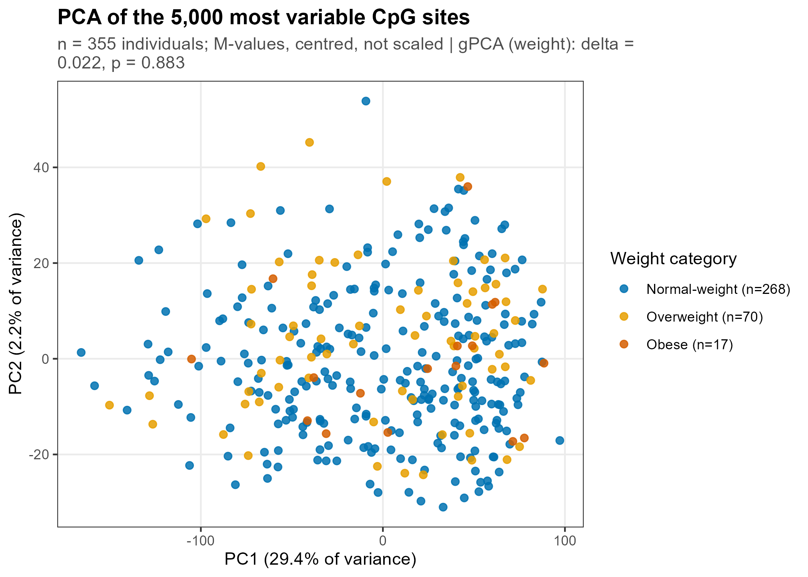
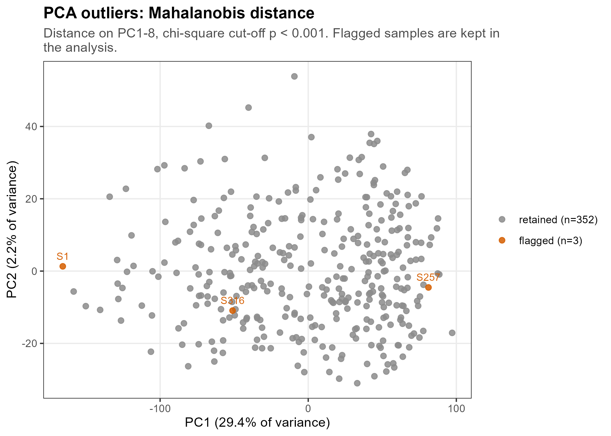
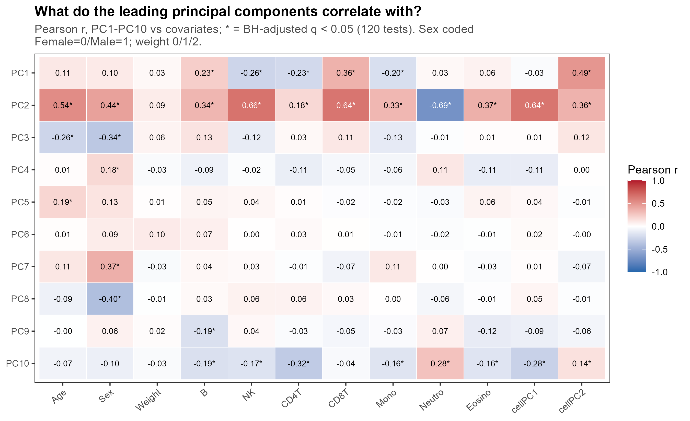
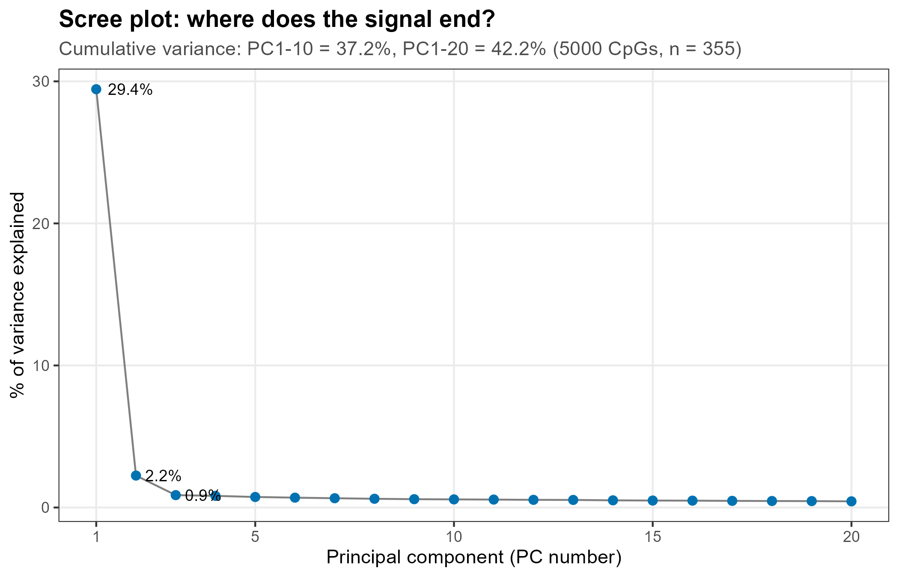
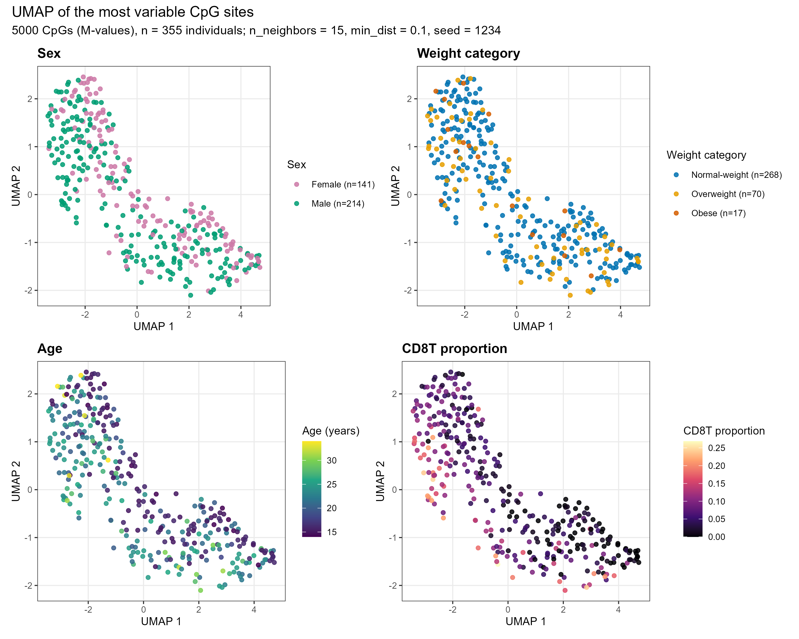

```{r setup, include = FALSE}
# All chunks run with the repository root as the working directory (data, results/ and figures/ are there).
knitr::opts_knit$set(root.dir = normalizePath(".."))
knitr::opts_chunk$set(echo = TRUE, comment = "#>")
```

**Slides:** Output of the code corresponds to slides: 1 (dataset), 2 (cohort), 3 (PCA), 4 (UMAP); backup 16 (outliers), 17 (gPCA and PC–covariate correlations), 18 (scree plot) of the presentation.

This report loads the data, checks it, and describes the main structure of the methylation
data before any hypothesis is tested. The objects it creates (`beta_mat`, `mvals_full`,
`pheno`, `pca`, `cellcomp`, `anno`, ...) are used by all later reports, so the reports
must be rendered in order in one R session (`source("run_all.R")`).

```{r packages}
source("R/functions.R")
source("R/input_files.R")
```

## Settings

```{r settings}
SEED         <- 1234    # random seed (for gPCA permutations, UMAP)
EPS          <- 1e-6    # beta is clipped to [EPS, 1 - EPS] before the logit, to avoid log(0) and #log (1/0)
TOP_N_CPG    <- 5000    # number of most variable CpGs used for PCA, gPCA and UMAP
N_PC_OUTLIER <- 8       # number of principal components in the Mahalanobis distance
OUTLIER_P    <- 0.001   # chi-square cut-off for the outlier flag
GPCA_NPERM   <- 1000    # permutations in the gPCA test
N_PC_HEATMAP <- 10      # PCs correlated with the covariates
UMAP_NEIGHBORS <- 15    # UMAP: number of neighbours of each point
UMAP_MIN_DIST  <- 0.1   # UMAP: how tightly points may be packed

set.seed(SEED)
```

## Input files

Three input files are needed (see the README, *Data* section). The phenotype table is downloaded
from GEO automatically if it is missing. The md5 checksums identify the exact
file versions and can be compared with `session_info/data_checksums.csv`.

```{r input-files}
if (!file.exists(PHENO_FILE)) download_phenotypes()
input_files <- c(BETA_FILE, PHENO_FILE, SNP_DOCX)
missing_files <- input_files[!file.exists(input_files)]
if (length(missing_files) > 0) {
  stop("Input file(s) not found: ", paste(basename(missing_files), collapse = ", "),
       "\nLooked in: ", normalizePath(DATA_DIR),
       "\nPut them in the repository root or set Sys.setenv(GSE73103_DATA_DIR = \"<folder with the files>\").",
       call. = FALSE)
}
cat("Input folder:", normalizePath(DATA_DIR), "\n")
data.frame(file = basename(input_files), bytes = file.size(input_files), md5 = unname(tools::md5sum(input_files)))
```

## Methylation matrix

The GEO file has 711 columns: the probe ID, for each of the 355 samples a column of
beta values (`S1`, `S2`, ...) and a column of detection p-values (`Detection Pval S1`, ...).
Only the beta columns are kept. A **beta value** is the fraction of methylated DNA copies at
one CpG site in one sample (0 = unmethylated in all DNA copies, 1 = methylated in all copies).

Reading the 2.9 GB text file takes several minutes, so the matrix is saved once in R format
(`results/beta_matrix.rds`) and reloaded from there on later runs. 

```{r read-beta}
if (file.exists(BETA_CACHE)) {
  beta_mat <- readRDS(BETA_CACHE)
} else {
  beta_table <- fread(BETA_FILE, nThread = max(1, parallel::detectCores() - 1))
  cpg_ids <- beta_table[[1]]
  stopifnot(!anyDuplicated(cpg_ids))
  beta_columns <- !grepl("^Detection", colnames(beta_table))
  beta_columns[1] <- FALSE                     # the first column is the probe ID
  beta_mat <- as.matrix(beta_table[, beta_columns, with = FALSE])
  rownames(beta_mat) <- cpg_ids
  rm(beta_table)
  saveRDS(beta_mat, BETA_CACHE)
}
dim(beta_mat)
```

The paper reports no missing values, and the authors already removed the probes on the
X and Y chromosomes. Both facts are checked here with the 450K annotation (chromosome,
position and gene of every probe, from the Bioconductor package
`IlluminaHumanMethylation450kanno.ilmn12.hg19`).

```{r missing-and-xy}
n_missing <- sum(is.na(beta_mat))
cat("Missing values:", n_missing, "\n")
stopifnot(n_missing == 0)      # the fast regressions in later reports assume complete data

suppressPackageStartupMessages(library(IlluminaHumanMethylation450kanno.ilmn12.hg19))
anno <- minfi::getAnnotation(IlluminaHumanMethylation450kanno.ilmn12.hg19)
probe_chr <- anno$chr[match(rownames(beta_mat), rownames(anno))]
n_xy <- sum(probe_chr %in% c("chrX", "chrY"))
cat("Probes on chromosomes X/Y:", n_xy, "\n")
```

## Phenotypes and cohort (slides 1–2)

The sample names in the phenotype table (`Whole blood_S1`, ...) are matched to the columns of
the methylation matrix, so that row *i* of `pheno` always describes column *i* of `beta_mat`.
GEO gives no batch or plate ID, so batch effects can only be checked indirectly (PCs against
covariates and gPCA below, and the PC-adjusted EWAS model M2 in report 4).

```{r phenotypes}
pheno <- fread(PHENO_FILE, data.table = FALSE)
pheno$title <- trimws(pheno$title)
pheno$age <- as.numeric(pheno$age)
pheno$Sex <- factor(pheno$Sex)
pheno$weight.category <- factor(pheno$weight.category,
                                levels = c("Normal-weight", "Overweight", "Obese"))
pheno$sample_id <- sub("^Whole blood_", "", pheno$title)
pheno <- pheno[match(colnames(beta_mat), pheno$sample_id), ]
stopifnot(all(colnames(beta_mat) == pheno$sample_id))

qc_summary <- data.frame(
  n_cpg = nrow(beta_mat), n_samples = ncol(beta_mat), n_missing = n_missing, n_xy_probes = n_xy,
  n_normal = sum(pheno$weight.category == "Normal-weight"),
  n_overweight = sum(pheno$weight.category == "Overweight"),
  n_obese = sum(pheno$weight.category == "Obese"))
write.csv(qc_summary, result_path("qc_summary.csv"), row.names = FALSE)
qc_summary
```

Slide 2 describes the cohort. BMI is only available as a category: for adults
cut-offs are (< 25, 25–30, ≥ 30 kg/m²), for teenagers the age- and sex-specific cut-offs of
Cole et al. 2000. The cohort consists of two groups: teenagers (14–16 years) and young
adults (18–34 years).

```{r cohort}
table(pheno$weight.category)
cat(sprintf("Age: %g-%g years, median %g, IQR %g-%g\n", min(pheno$age), max(pheno$age),
            median(pheno$age), quantile(pheno$age, 0.25), quantile(pheno$age, 0.75)))
age_group <- ifelse(pheno$age < 17, "teens (14-16)", "adults (18-34)")
table(age_group, pheno$Sex)
```

## M-values and the 5,000 most variable CpGs (backup slide 16)

Beta values are squeezed near 0 and 1, where their variance is small. The **M-value**,
M = log₂(β / (1 − β)), stretches both ends and has a more constant variance, which suits
linear models and PCA. `mvals_full` holds the M-values of all 397,615 CpGs and is used by
the meQTL and EWAS reports.

For the overview methods (PCA, gPCA, outliers, UMAP) only the 5,000 CpGs with the largest
variance of M across people are used. The selection uses no labels (weight, sex, age), so it
cannot favour any group.

```{r m-values}
beta_clipped <- pmin(pmax(beta_mat, EPS), 1 - EPS)
mvals_full <- log2(beta_clipped / (1 - beta_clipped))
rm(beta_clipped)

cpg_variance <- rowVars(mvals_full)
top_rows <- order(cpg_variance, decreasing = TRUE)[1:TOP_N_CPG]
mvals_top <- mvals_full[top_rows, ]
dim(mvals_top)
```

## PCA (slide 3)

Principal component analysis finds the directions (PC1, PC2, ...) along which the 355 people
differ most in these 5,000 CpGs. The data are centred but not scaled, because all CpGs are on
the same M-value scale.

```{r pca}
pca <- prcomp(t(mvals_top), center = TRUE, scale. = FALSE)
var_explained <- pca$sdev^2 / sum(pca$sdev^2) * 100   # % of variance of each PC
cat(sprintf("PC1: %.1f%%  PC2: %.1f%%\n", var_explained[1], var_explained[2]))
```

### Outliers by Mahalanobis distance (backup slide 16)

The Mahalanobis distance measures how far a person lies from the centre of the cloud on
PC1–PC8, taking the spread of each PC into account. `mahalanobis()` returns the **squared**
distance; under a normal distribution it follows a χ² distribution with 8 degrees of freedom,
and people above its 99.9 % quantile are flagged (column `maha_dist` holds the squared distance). Flagged people are **kept** in all analyses: being far from the centre
does not prove a technical failure. However, their effect is checked as one of the EWAS sensitivity
models (report 5).

```{r outliers}
pcs_for_outliers <- pca$x[, 1:N_PC_OUTLIER]
maha_dist <- mahalanobis(pcs_for_outliers, colMeans(pcs_for_outliers), cov(pcs_for_outliers))
maha_cutoff <- qchisq(1 - OUTLIER_P, df = N_PC_OUTLIER)
outliers <- data.frame(sample_id = rownames(pca$x), maha_dist = maha_dist, cutoff = maha_cutoff,
                       flagged = maha_dist > maha_cutoff, PC1 = pca$x[, 1], PC2 = pca$x[, 2],
                       pheno[, c("Sex", "age", "weight.category")])
outlier_ids <- outliers$sample_id[outliers$flagged]
write.csv(outliers, result_path("pca_outliers.csv"), row.names = FALSE)
outliers[outliers$flagged, ]
```

### gPCA: is sex or weight category the main axis of variation? (backup slide 17)

**Guided PCA** (Reese et al. 2013) asks whether a known grouping is the *main* axis of
variation, as a batch effect would be.

- δ = variance along the direction that best separates the groups ÷ variance along PC1.
  δ ≈ 1 means the grouping *is* PC1; δ near 0 means it carries little of the main variation.
- p = share of 1,000 random relabellings of the people with δ at least as large as observed.

With many more CpGs than people even random groupings reach a sizeable δ, so δ is judged
against the permutation p-value, not against 0. `gPCA.batchdetect()` needs the groups coded
as integers 1…k, hence `as.integer(factor(...))`.

```{r gpca}
run_gpca <- function(groups, label) {
  # center = FALSE tells gPCA that the data are NOT centred yet, so gPCA centres them itself
  out <- gPCA.batchdetect(x = t(mvals_top), batch = as.integer(factor(groups)),
                          nperm = GPCA_NPERM, center = FALSE, seed = SEED)
  cat(sprintf("gPCA [%s]: delta = %.3f, p = %.4f\n", label, out$delta, out$p.val))
  group_sizes <- table(groups)
  data.frame(variable = label, delta = out$delta, p_value = out$p.val, nperm = GPCA_NPERM, seed = SEED,
             group_sizes = paste(names(group_sizes), group_sizes, sep = "=", collapse = "; "))
}
gpca_tab <- rbind(run_gpca(pheno$Sex, "sex"),
                  run_gpca(pheno$weight.category, "weight category"))
write.csv(gpca_tab, result_path("gpca_results.csv"), row.names = FALSE)
```

### Figure 1 (slide 3): PCA coloured by weight category

```{r fig01-pca}
gpca_weight <- gpca_tab[gpca_tab$variable == "weight category", ]
scores <- data.frame(sample_id = rownames(pca$x), PC1 = pca$x[, 1], PC2 = pca$x[, 2],
                     weight = pheno$weight.category, stringsAsFactors = FALSE)
scores <- order_rare_last(scores, scores$weight)

p_weight <- ggplot(scores, aes(PC1, PC2, colour = weight)) +
  geom_point(size = 1.9, alpha = 0.85) +
  scale_colour_weight(pheno$weight.category) +
  labs(title = sprintf("PCA of the %s most variable CpG sites", format(TOP_N_CPG, big.mark = ",")),
       subtitle = sprintf("n = %d individuals; M-values, centred, not scaled  |  gPCA (weight): delta = %.3f, p = %.3f",
                          nrow(pheno), gpca_weight$delta, gpca_weight$p_value),
       x = pc_label(pca, 1), y = pc_label(pca, 2)) +
  theme_gse()
save_fig(p_weight, "01_pca_by_weight", width = 7, height = 5)
```



### Figure 2 (backup slide 16): flagged outliers

```{r fig02-outliers}
scores$flagged <- outliers$flagged[match(scores$sample_id, outliers$sample_id)]
scores$label <- ifelse(scores$flagged, scores$sample_id, NA_character_)
scores <- scores[order(scores$flagged), ]        # flagged samples are drawn on top

p_out <- ggplot(scores, aes(PC1, PC2, colour = flagged)) +
  geom_point(size = 1.9, alpha = 0.85) +
  geom_text(aes(label = label), vjust = -0.9, size = 3, show.legend = FALSE, na.rm = TRUE) +
  scale_colour_manual(values = PAL_FLAG, breaks = c("FALSE", "TRUE"),
                      labels = c(sprintf("retained (n=%d)", sum(!outliers$flagged)),
                                 sprintf("flagged (n=%d)", sum(outliers$flagged))),
                      name = NULL) +
  labs(title = "PCA outliers: Mahalanobis distance",
       subtitle = sprintf("Distance on PC1-%d, chi-square cut-off p < %g. Flagged samples are kept in the analysis.",
                          N_PC_OUTLIER, OUTLIER_P),
       x = pc_label(pca, 1), y = pc_label(pca, 2)) +
  theme_gse()
save_fig(p_out, "02_pca_outliers", width = 7, height = 5)
```



## Blood cell composition (EpiDISH)

Cell mixture varies between people => it's composition is a major source of methylation variation.
GEO gives no cell counts, so the proportions of 7 cell types are **estimated from the
methylation itself** with EpiDISH (robust partial correlations, `method = "RPC"`) and its
blood reference `centDHSbloodDMC.m`.

7 correlated proportions are too many covariates for every model, so they are summarised by
their first two principal components, **cellPC1** and **cellPC2** (PCA of the standardised
proportions). These two numbers are the cell-composition covariates in all later models.

```{r cell-composition}
data(centDHSbloodDMC.m)
common_cpg <- intersect(rownames(beta_mat), rownames(centDHSbloodDMC.m))
cat("CpGs shared with the EpiDISH reference:", length(common_cpg), "\n")
cellcomp <- epidish(beta.m = beta_mat[common_cpg, ], ref.m = centDHSbloodDMC.m[common_cpg, ],
                    method = "RPC")$estF
write.csv(cellcomp, result_path("cell_composition.csv"))
round(head(cellcomp), 3)

cellcomp <- cellcomp[match(pheno$sample_id, rownames(cellcomp)), ]   # same order as pheno
cell_pca <- prcomp(cellcomp, center = TRUE, scale. = TRUE)
pheno$cellPC1 <- cell_pca$x[, 1]
pheno$cellPC2 <- cell_pca$x[, 2]
pheno$weight_num <- as.numeric(pheno$weight.category) - 1   # Normal = 0, Overweight = 1, Obese = 2
```

## What do the principal components correlate with? (slides 3, 17)

Each of PC1–PC10 is correlated (Pearson r) with every available covariate: age, sex
(Female = 0, Male = 1), weight category (0/1/2), the 7 cell proportions and cellPC1/2.
These are 120 tests, so the p-values are corrected with Benjamini–Hochberg (BH); a star in the
heatmap marks q < 0.05.

```{r pc-correlations}
covars <- data.frame(Age = pheno$age,
                     Sex = as.numeric(pheno$Sex) - 1,
                     Weight = pheno$weight_num,
                     cellcomp,
                     cellPC1 = pheno$cellPC1,
                     cellPC2 = pheno$cellPC2,
                     check.names = FALSE)

pc_cor <- expand.grid(pc = 1:N_PC_HEATMAP, covariate = colnames(covars), stringsAsFactors = FALSE)
pc_cor$r <- NA_real_
pc_cor$p <- NA_real_
for (i in 1:nrow(pc_cor)) {
  test <- cor.test(pca$x[, pc_cor$pc[i]], covars[[pc_cor$covariate[i]]])
  pc_cor$r[i] <- unname(test$estimate)
  pc_cor$p[i] <- test$p.value
}
pc_cor$q <- p.adjust(pc_cor$p, method = "BH")
write.csv(pc_cor, result_path("pc_covariate_correlations.csv"), row.names = FALSE)

# correlations of PC1 and PC2 (numbers quoted on slide 17)
round(xtabs(r ~ covariate + pc, data = pc_cor[pc_cor$pc <= 2, ]), 3)
```

```{r fig03-heatmap}
heat <- pc_cor
heat$covariate <- factor(heat$covariate, levels = c("Age", "Sex", "Weight", colnames(cellcomp), "cellPC1", "cellPC2"))
heat$pc_label <- factor(paste0("PC", heat$pc), levels = paste0("PC", N_PC_HEATMAP:1))
heat$label <- sprintf("%.2f%s", heat$r, ifelse(heat$q < 0.05, "*", ""))
heat$text_colour <- ifelse(abs(heat$r) > 0.6, "white", "black")
heat_subtitle <- sprintf("Pearson r, PC1-PC%d vs covariates; * = BH-adjusted q < 0.05 (%d tests). Sex coded Female=0/Male=1; weight 0/1/2.",
                         N_PC_HEATMAP, nrow(heat))
p_heat <- ggplot(heat, aes(x = covariate, y = pc_label, fill = r)) +
  geom_tile(colour = "white") +
  geom_text(aes(label = label, colour = text_colour), size = 2.7) +
  scale_colour_identity() +
  scale_fill_gradient2(low = "#2166AC", mid = "white", high = "#B2182B", limits = c(-1, 1), name = "Pearson r") +
  labs(title = "What do the leading principal components correlate with?",
       subtitle = wrap_text(heat_subtitle, 95), x = NULL, y = NULL) +
  theme_gse() +
  theme(axis.text.x = element_text(angle = 40, hjust = 1), panel.grid = element_blank())
save_fig(p_heat, "03_pc_covariate_heatmap", width = 9, height = 5.5)
```



## Scree plot (backup slide 18)

The scree plot shows the share of variance of each PC. After the first few PCs the curve
flattens: the remaining components each carry little variance.

```{r fig04-scree}
scree <- data.frame(pc = 1:20, pct = var_explained[1:20])
p_scree <- ggplot(scree, aes(pc, pct)) +
  geom_line(colour = "grey50") +
  geom_point(size = 2, colour = "#0072B2") +
  geom_text(data = scree[1:3, ], aes(label = sprintf("%.1f%%", pct)), hjust = -0.25, size = 3.2) +
  scale_x_continuous(breaks = c(1, 5, 10, 15, 20)) +
  labs(title = "Scree plot: where does the signal end?",
       subtitle = sprintf("Cumulative variance: PC1-10 = %.1f%%, PC1-20 = %.1f%% (%d CpGs, n = %d)",
                          sum(var_explained[1:10]), sum(var_explained[1:20]), nrow(mvals_top), ncol(mvals_top)),
       x = "Principal component (PC number)", y = "% of variance explained") +
  theme_gse()
save_fig(p_scree, "04_scree_plot", width = 7, height = 4.5)

write.csv(data.frame(pc = seq_along(var_explained), pct = var_explained, cumulative_pct = cumsum(var_explained)),
          result_path("pca_variance_explained.csv"), row.names = FALSE)
```



## UMAP (slide 4)

UMAP places the 355 people on a 2-D map so that people with similar methylation (over the
same 5,000 CpGs, all 355 people, no PCA step before it) end up close together.
`n_neighbors = 15` sets how many neighbours define the local structure, and `min_dist = 0.1`
how tightly points may be packed. UMAP is random; with a fixed seed and one thread
(`n_threads = 1`) the map is reproducible.

The four panels colour the same map by sex, weight category, age and the cell type that
correlates most strongly with PC1 (chosen from the data, not fixed in advance).

```{r umap}
r_pc1_cell <- cor(pca$x[, 1], cellcomp)[1, ]
top_cell <- names(which.max(abs(r_pc1_cell)))
cat(sprintf("Cell type with the largest |r| with PC1: %s (r = %.2f)\n", top_cell, r_pc1_cell[top_cell]))

set.seed(SEED)
umap_xy <- umap(t(mvals_top), n_neighbors = UMAP_NEIGHBORS, min_dist = UMAP_MIN_DIST,
                metric = "euclidean", n_threads = 1)
```

```{r fig05-umap}
d_umap <- data.frame(U1 = umap_xy[, 1], U2 = umap_xy[, 2], Sex = pheno$Sex,
                     weight = pheno$weight.category, Age = pheno$age, cell = cellcomp[, top_cell])
d_umap <- order_rare_last(d_umap, d_umap$weight)

umap_panel <- function(colour_var, colour_scale, title) {
  ggplot(d_umap, aes(U1, U2, colour = .data[[colour_var]])) +
    geom_point(size = 1.5, alpha = 0.85) +
    colour_scale +
    labs(title = title, x = "UMAP 1", y = "UMAP 2") +
    theme_gse(10)
}
cell_lab <- sprintf("%s proportion", top_cell)
p_sex    <- umap_panel("Sex", scale_colour_sex(pheno$Sex), "Sex")
p_wgt    <- umap_panel("weight", scale_colour_weight(pheno$weight.category), "Weight category")
p_age    <- umap_panel("Age", scale_colour_viridis_c(name = "Age (years)"), "Age")
p_cell   <- umap_panel("cell", scale_colour_viridis_c(name = cell_lab, option = "magma"), cell_lab)

p_umap <- (p_sex | p_wgt) / (p_age | p_cell) +
  plot_annotation(title = "UMAP of the most variable CpG sites",
                  subtitle = sprintf("%d CpGs (M-values), n = %d individuals; n_neighbors = %d, min_dist = %g, seed = %d",
                                     nrow(mvals_top), ncol(mvals_top), UMAP_NEIGHBORS, UMAP_MIN_DIST, SEED))
save_fig(p_umap, "05_umap", width = 10, height = 8)
```


