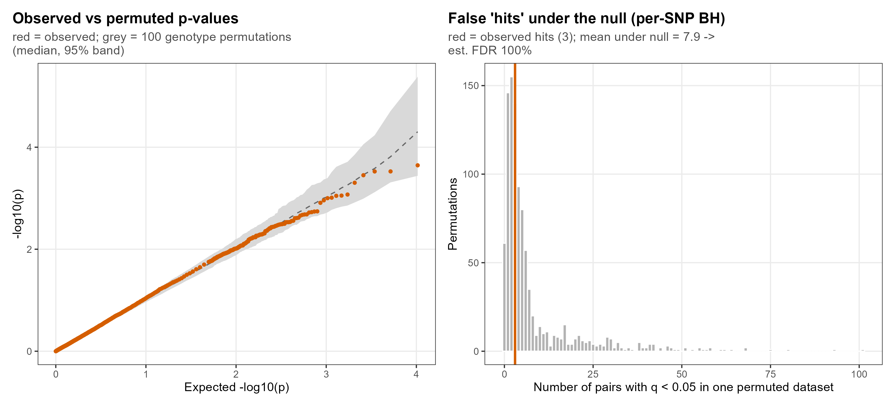
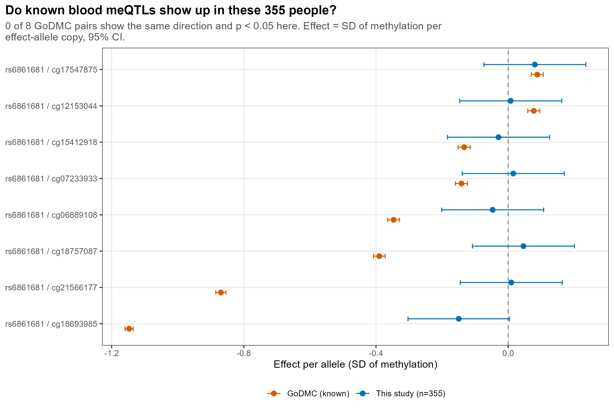

```{r setup, include = FALSE}
knitr::opts_knit$set(root.dir = normalizePath(".."))
knitr::opts_chunk$set(echo = TRUE, comment = "#>")
```

**Slides:** 5 (meQTL design), 6 (3 hits vs permutations), 7 (known meQTLs, GoDMC);
backup 19 (SNP table), 20 (annotation of the hits).

A **cis-meQTL** (methylation quantitative trait loci) is a SNP whose genotype changes the
methylation of a CpG close to it ("cis" = within ±500 kb here). This report repeats the
paper's meQTL analysis for the 52 obesity SNPs, then asks whether the few hits are real:
first with genotype permutations, then with known strong blood meQTLs as a positive control.

```{r packages}
source("R/functions.R")
source("R/input_files.R")
need_objects(c("pheno", "beta_mat", "mvals_full", "anno"), "analysis/01_data_pca_umap.Rmd")
```

## Settings

```{r settings}
CIS_WINDOW <- 500000   # CpGs within +-500 kb of the SNP are tested
MIN_HOM_N  <- 10       # a homozygous class with fewer people is merged into the heterozygotes (paper's rule)
FDR_ALPHA  <- 0.05
COUNT_CONFLICT_MARGIN <- 10   # tolerance when comparing genotype counts with the paper's table
FU_SEED    <- 1234     # seed of the permutation step (the permutations use FU_SEED + 7)
N_PERM     <- 1000     # genotype permutations
N_PERM_QQ  <- 100      # permutations drawn in the QQ band of figure 6
```

## The 52 SNPs (backup slide 19)

The genotypes in GEO are letters (e.g. `A/G`). To count risk alleles, the risk allele and the
hg19 position of each SNP are needed; both come from the paper's Additional file 1.

```{r snp-table}
if (!file.exists(SNP_TABLE)) read_snp_table_docx()
snp_tab <- read.csv(SNP_TABLE, stringsAsFactors = FALSE)
snp_tab$pos <- as.numeric(snp_tab$pos)
head(snp_tab[, c("snp", "chr", "pos", "gene", "risk_allele", "genotype_freq")])
```

## Genotypes as dosage 

Each genotype becomes a **dosage**: the number of copies of the risk allele (0, 1 or 2).

**Strand.** The paper's risk allele and the GEO letters are not always written on the same DNA
strand (A pairs with T, C with G). If the risk letter does not occur among the GEO letters but
its complement does, the complement is used. For a **palindromic** SNP
(A/T or C/G) the letters cannot tell the strand, so the numbers of homozygotes are compared
with the paper's genotype counts instead. For every SNP the final choice is also checked
against the paper's counts; a disagreement is flagged as a conflict (only the *sign* of the
effect is then unreliable: the p-value does not change).

Helper functions:

```{r strand-functions}
complement <- c(A = "T", T = "A", C = "G", G = "C")

# Homozygote counts in the paper's string "A/A: 94(27%); A/G: 175(49%); G/G: 86(24%)":
# returns the number of risk-allele homozygotes and of the other homozygotes.
paper_hom_counts <- function(freq_string, risk) {
  entries <- regmatches(freq_string, gregexpr("[ACGT]/[ACGT]:[[:space:]]*[0-9]+", freq_string))[[1]]
  result <- list(riskhom = NA_real_, nonriskhom = NA_real_)
  if (length(entries) == 0) return(result)
  allele1 <- substr(entries, 1, 1)
  allele2 <- substr(entries, 3, 3)
  count <- as.numeric(sub(".*:[[:space:]]*", "", entries))
  all_letters <- unique(c(allele1, allele2))
  if (!(risk %in% all_letters)) return(result)
  homozygotes <- function(a) {
    i <- which(allele1 == a & allele2 == a)
    if (length(i) == 0) 0 else count[i[1]]
  }
  other <- setdiff(all_letters, risk)
  result$riskhom <- homozygotes(risk)
  if (length(other) == 1) result$nonriskhom <- homozygotes(other)
  result
}

# Number of homozygotes of a given letter in the GEO genotypes (e.g. "G" counts "G/G").
geo_hom_count <- function(genotypes, letter) {
  if (is.na(letter)) return(0)
  n <- 0
  for (alleles in strsplit(genotypes[!is.na(genotypes)], "/")) {
    if (length(alleles) == 2 && alleles[1] == letter && alleles[2] == letter) n <- n + 1
  }
  n
}

# Genotype strings -> number of copies of `risk_letter` (NA if the genotype is missing).
genotype_to_dosage <- function(genotypes, risk_letter) {
  dosage <- rep(NA_real_, length(genotypes))
  for (i in seq_along(genotypes)) {
    alleles <- strsplit(genotypes[i], "/")[[1]]
    if (length(alleles) == 2 && !any(is.na(alleles))) dosage[i] <- sum(alleles == risk_letter)
  }
  dosage
}
```

The strand decision and the dosage, SNP by SNP:

```{r dosage}
dosage_mat <- matrix(NA_real_, nrow = nrow(pheno), ncol = nrow(snp_tab),
                     dimnames = list(pheno$sample_id, snp_tab$snp))
strand_log <- data.frame()

for (i in 1:nrow(snp_tab)) {
  snp <- snp_tab$snp[i]
  risk <- snp_tab$risk_allele[i]
  flipped <- unname(complement[risk])
  genotypes <- pheno[[snp]]
  observed_letters <- sort(unique(unlist(strsplit(genotypes[!is.na(genotypes)], "/"))))
  paper <- paper_hom_counts(snp_tab$genotype_freq[i], risk)

  # distance between GEO and paper homozygote counts if `letter` were the risk allele
  # and `other` the non-risk allele (NA if the paper's counts are not available)
  count_misfit <- function(letter, other) {
    abs(geo_hom_count(genotypes, letter) - paper$riskhom) + abs(geo_hom_count(genotypes, other) - paper$nonriskhom)
  }

  palindromic <- length(observed_letters) == 2 &&
    (all(observed_letters %in% c("A", "T")) || all(observed_letters %in% c("C", "G"))) && risk %in% observed_letters

  if (palindromic) {
    misfit_same <- count_misfit(risk, flipped)
    misfit_flip <- count_misfit(flipped, risk)
    if (is.na(misfit_same) || is.na(misfit_flip)) {
      use <- risk; method <- "palindromic: paper counts unavailable, same strand assumed"
    } else if (misfit_flip + COUNT_CONFLICT_MARGIN <= misfit_same) {
      use <- flipped; method <- "palindromic: genotype counts -> complement"
    } else if (misfit_same + COUNT_CONFLICT_MARGIN <= misfit_flip) {
      use <- risk; method <- "palindromic: genotype counts -> same strand"
    } else {
      use <- risk; method <- "palindromic: AMBIGUOUS, same strand assumed"
    }
  } else if (risk %in% observed_letters) {
    use <- risk; method <- "letter match"
  } else if (flipped %in% observed_letters) {
    use <- flipped; method <- "complement (strand flip)"
  } else {
    warning(snp, ": neither the risk allele nor its complement occurs in the GEO genotypes")
    use <- risk; method <- "NOT FOUND"
  }

  # independent check of the decision with the paper's genotype counts
  other <- setdiff(observed_letters, use)
  if (length(other) != 1) other <- NA_character_
  misfit_decided <- count_misfit(use, other)
  misfit_swapped <- count_misfit(other, use)
  conflict <- !is.na(misfit_decided) && !is.na(misfit_swapped) &&
    (misfit_decided - misfit_swapped >= COUNT_CONFLICT_MARGIN)

  # dosage; a homozygous class with < MIN_HOM_N people is merged into the heterozygotes
  dosage <- genotype_to_dosage(genotypes, use)
  merged <- character(0)
  for (d in c(0, 2)) {
    n_d <- sum(dosage == d, na.rm = TRUE)
    if (n_d > 0 && n_d < MIN_HOM_N) {
      dosage[!is.na(dosage) & dosage == d] <- 1
      merged <- c(merged, as.character(d))
    }
  }
  dosage_mat[, i] <- dosage

  strand_log <- rbind(strand_log, data.frame(
    snp = snp, risk_allele_paper = risk, observed_letters = paste(observed_letters, collapse = "/"),
    risk_allele_used = use, method = method, palindromic = palindromic,
    paper_riskhom = paper$riskhom, paper_nonriskhom = paper$nonriskhom,
    geo_hom_used = geo_hom_count(genotypes, use), geo_hom_other = geo_hom_count(genotypes, other),
    fit_decided = misfit_decided, fit_swapped = misfit_swapped, count_conflict = conflict,
    n_dosage0 = sum(dosage == 0, na.rm = TRUE), n_dosage1 = sum(dosage == 1, na.rm = TRUE),
    n_dosage2 = sum(dosage == 2, na.rm = TRUE), merged_classes = paste(merged, collapse = ","),
    stringsAsFactors = FALSE))
}
write.csv(strand_log, result_path("snp_strand_log.csv"), row.names = FALSE)

table(strand_log$method)
cat("SNPs with a genotype-count conflict (sign of the effect unreliable):",
    paste(strand_log$snp[strand_log$count_conflict], collapse = ", "), "\n")
cat("Missing genotypes:", sum(is.na(dosage_mat)), "\n")
```

## cis windows: which CpGs are tested for which SNP

```{r cis-windows}
cpg_pos <- data.frame(cpg = rownames(anno), chr = anno$chr, pos = anno$pos, stringsAsFactors = FALSE)
cpg_pos <- cpg_pos[cpg_pos$cpg %in% rownames(mvals_full), ]

cis_cpgs <- list()
for (i in 1:nrow(snp_tab)) {
  in_window <- cpg_pos$chr == snp_tab$chr[i] & abs(cpg_pos$pos - snp_tab$pos[i]) <= CIS_WINDOW
  cis_cpgs[[snp_tab$snp[i]]] <- cpg_pos$cpg[in_window]
}
n_cis <- lengths(cis_cpgs)
cat("CpGs per SNP window: median", median(n_cis), "; total SNP-CpG pairs:", sum(n_cis), "\n")
```

## The meQTL test (slide 5)

For each SNP–CpG pair two linear models are fitted to the M-value of the CpG:

- full model: `M ~ Sex + Age + Weight + Genotype + cellPC1 + cellPC2` (the paper's model;
  Weight = 0/1/2, Genotype = dosage);
- null model: the same without `Genotype`.

The **likelihood-ratio test** (`lmtest::lrtest`) compares them:
LR = 2 × (log-likelihood of the full model − log-likelihood of the null model). If the genotype
has no effect, LR follows a χ² distribution with 1 degree of freedom (one extra parameter),
which gives the p-value.

There are ~10,000 pairs, so many p-values are small by chance. Two corrections are reported:

- **per-SNP BH**: Benjamini–Hochberg FDR within each SNP's window separately. This is the
  paper's rule. The global q-value gives 0 hits, so the 3 hits depend on this choice of
  correction, which was made after seeing the global result (post hoc);
- **global q-value** (Storey) over all pairs together.

This loop takes a few minutes.

```{r meqtl-loop}
covariates <- data.frame(Sex = pheno$Sex, Age = pheno$age, Weight = pheno$weight_num,
                         cellPC1 = pheno$cellPC1, cellPC2 = pheno$cellPC2)
results <- list()
for (i in 1:nrow(snp_tab)) {
  snp <- snp_tab$snp[i]
  genotype <- dosage_mat[, snp]
  ok <- !is.na(genotype)
  for (cpg in cis_cpgs[[snp]]) {
    d <- data.frame(M = mvals_full[cpg, ok], covariates[ok, ], Genotype = genotype[ok])
    fit_full <- lm(M ~ Sex + Age + Weight + Genotype + cellPC1 + cellPC2, data = d)
    fit_null <- lm(M ~ Sex + Age + Weight + cellPC1 + cellPC2, data = d)
    coefs <- coef(summary(fit_full))
    lr <- lrtest(fit_null, fit_full)
    results[[length(results) + 1]] <- data.frame(
      snp = snp, cpg = cpg,
      beta_genotype = coefs["Genotype", "Estimate"],
      se_genotype = coefs["Genotype", "Std. Error"],
      p_value = lr$`Pr(>Chisq)`[2],
      n = nrow(d))
  }
  if (i %% 5 == 0) cat(sprintf("...%d/%d SNPs\n", i, nrow(snp_tab)))
}
meqtl_res <- do.call(rbind, results)
```

```{r meqtl-fdr}
meqtl_res$q_value <- qvalue(meqtl_res$p_value)$qvalues          # global Storey q-value
meqtl_res$q_value_per_snp <- NA_real_                           # BH within each SNP's window
for (snp in unique(meqtl_res$snp)) {
  rows <- meqtl_res$snp == snp
  meqtl_res$q_value_per_snp[rows] <- p.adjust(meqtl_res$p_value[rows], method = "BH")
}

# position information for interpretation
i_snp <- match(meqtl_res$snp, snp_tab$snp)
i_cpg <- match(meqtl_res$cpg, cpg_pos$cpg)
meqtl_res$gene_snp <- snp_tab$gene[i_snp]
meqtl_res$risk_allele_used <- strand_log$risk_allele_used[match(meqtl_res$snp, strand_log$snp)]
meqtl_res$cpg_chr <- cpg_pos$chr[i_cpg]
meqtl_res$cpg_pos <- cpg_pos$pos[i_cpg]
meqtl_res$dist_to_snp_bp <- meqtl_res$cpg_pos - snp_tab$pos[i_snp]

meqtl_res <- meqtl_res[order(meqtl_res$q_value_per_snp, meqtl_res$p_value), ]
write.csv(meqtl_res, result_path("cis_meqtl_results.csv"), row.names = FALSE)

meqtl_summary <- data.frame(
  n_samples = ncol(mvals_full), n_snps = nrow(snp_tab), n_pairs_tested = nrow(meqtl_res),
  cis_window_bp = CIS_WINDOW, fdr_alpha = FDR_ALPHA,
  n_sig_global_qvalue = sum(meqtl_res$q_value < FDR_ALPHA),
  n_sig_per_snp_bh = sum(meqtl_res$q_value_per_snp < FDR_ALPHA),
  n_snps_with_hit = length(unique(meqtl_res$snp[meqtl_res$q_value_per_snp < FDR_ALPHA])),
  lambda_gc = lambda_gc(meqtl_res$p_value),
  n_strand_flipped = sum(strand_log$method == "complement (strand flip)"),
  n_palindromic = sum(strand_log$palindromic),
  n_count_conflict = sum(strand_log$count_conflict))
write.csv(meqtl_summary, result_path("meqtl_summary.csv"), row.names = FALSE)
knitr::kable(meqtl_summary)
```

## The hits and their annotation (backup slide 20)

The CpG annotation (gene, position relative to a CpG island, regulatory class) comes from the
450K annotation. The GoDMC note says what the GoDMC meQTL database (mqtldb.godmc.org.uk,
queried 2026-10-07) reports for these CpGs.

```{r hits}
hits <- meqtl_res[meqtl_res$q_value_per_snp < FDR_ALPHA, ]
a <- anno[match(hits$cpg, rownames(anno)), ]
hits$cpg_gene <- a$UCSC_RefGene_Name
hits$cpg_gene_region <- a$UCSC_RefGene_Group
hits$cpg_island_relation <- a$Relation_to_Island
hits$cpg_regulatory_class <- a$Regulatory_Feature_Group
s <- strand_log[match(hits$snp, strand_log$snp), ]
hits$strand_method <- s$method
hits$snp_palindromic <- s$palindromic
hits$strand_count_conflict <- s$count_conflict
hits$merged_hom_classes <- s$merged_classes
hits$beta_sign_reliable <- !s$count_conflict

godmc_notes <- c(
  cg00647658 = "GoDMC cis-meQTL: rs2015991 (chr16:54,184,002; T allele -0.154 SD, p 1.5e-12, n=14,307) and rs4784357 (chr16:54,203,533; +0.180 SD, p 7.8e-9, n=21,113)",
  cg27057022 = "GoDMC cis-meQTL: rs2015991 (chr16:54,184,002; T allele -0.153 SD, p 2.0e-12, n=14,307)",
  cg25526920 = "no GoDMC meQTL at p < 1e-8")
hits$godmc_note <- unname(godmc_notes[hits$cpg])
hits$godmc_note[is.na(hits$godmc_note)] <- "not looked up"

write.csv(hits, result_path("meqtl_hits.csv"), row.names = FALSE)
hits[, c("snp", "cpg", "gene_snp", "beta_genotype", "p_value", "q_value_per_snp", "dist_to_snp_bp",
         "cpg_gene", "cpg_island_relation")]
```

##  3 hits check; Genotype permutations (slide 6)

Per-SNP BH controls the false discovery rate only *within* one SNP's window. Across 52
windows, a few false hits are expected even if no SNP has any effect. How many exactly is
estimated from the data themselves:

1. The genotype vector is shuffled across people, with the same random keys for all 52 SNPs
   (an identical shuffle when no genotype is missing), so the correlation between SNPs is kept. Methylation and covariates stay in place, so the
   correlation between CpGs is also kept, but any genotype–methylation link is destroyed.
2. The whole meQTL analysis with per-SNP BH is repeated on the shuffled data, and the number
   of "hits" is counted. Every such hit is false by construction.
3. 1,000 shuffles give the number of false hits expected by chance. Estimated FDR =
   expected false hits ÷ observed hits, capped at 100 % (7.9 ÷ 3 would be above 1).

10 million `lm()` fits would take days, so a fast equivalent of the same test is used: by the
Frisch–Waugh–Lovell theorem the LR statistic equals −n·log(1 − r²), where r is the
correlation between genotype and methylation after both have been adjusted for the
covariates. The fast version is first checked against the `lm()` results above.

```{r fast-meqtl}
covariates_num <- data.frame(Sex = as.numeric(pheno$Sex) - 1, Age = pheno$age, Weight = pheno$weight_num,
                             cellPC1 = pheno$cellPC1, cellPC2 = pheno$cellPC2)
cpgs_of_snp <- split(meqtl_res$cpg, meqtl_res$snp)   # the same SNP-CpG pairs as above

# Everything about one SNP that does not change between permutations
prepare_snp <- function(snp) {
  genotype <- dosage_mat[, snp]
  ok <- !is.na(genotype)
  M <- t(mvals_full[cpgs_of_snp[[snp]], ok, drop = FALSE])     # people x CpGs
  qx <- qr(cbind(1, as.matrix(covariates_num[ok, ])))          # QR decomposition of the covariates
  M_res <- M - qr.fitted(qx, M)                               # methylation adjusted for covariates
  list(snp = snp, cpg = cpgs_of_snp[[snp]], ok = ok, g = genotype[ok], n = sum(ok),
       qx = qx, M_res = M_res, ss_m = colSums(M_res^2))
}

# Likelihood-ratio p-values for one SNP and one or more genotype vectors (columns of G)
lrt_pvalues <- function(s, G) {
  G <- as.matrix(G)
  G_res <- G - qr.fitted(s$qx, G)                            # genotype adjusted for covariates
  ss_g <- colSums(G_res^2)
  r2 <- crossprod(G_res, s$M_res)^2 / outer(ss_g, s$ss_m)    # squared partial correlation
  r2 <- pmin(pmax(r2, 0), 1 - 1e-15)
  pchisq(-s$n * log1p(-r2), df = 1, lower.tail = FALSE)      # one row per column of G
}

snp_data <- list()
for (snp in names(cpgs_of_snp)) snp_data[[snp]] <- prepare_snp(snp)

observed <- data.frame()
for (snp in names(snp_data)) {
  s <- snp_data[[snp]]
  p <- as.numeric(lrt_pvalues(s, s$g))
  observed <- rbind(observed, data.frame(snp = snp, cpg = s$cpg, p = p,
                                         q_per_snp = p.adjust(p, "BH"), stringsAsFactors = FALSE))
}
check <- merge(observed, meqtl_res[, c("snp", "cpg", "p_value")], by = c("snp", "cpg"))
stopifnot(nrow(check) == nrow(meqtl_res))
cat(sprintf("Fast test vs lm + lrtest: max |difference in log10 p| = %.1e\n",
            max(abs(log10(check$p) - log10(check$p_value)))))
```

```{r permutations}
set.seed(FU_SEED + 7)
n_people <- nrow(pheno)
random_keys <- matrix(runif(n_people * N_PERM), n_people, N_PERM)   # one column = one shuffle of people

# Number of BH rejections (q < FDR_ALPHA) in each column of a CpG x permutation p-value matrix
count_bh_hits <- function(P) {
  m <- nrow(P)
  thresholds <- (1:m) / m * FDR_ALPHA
  hits <- numeric(ncol(P))
  for (b in 1:ncol(P)) {
    passed <- which(sort(P[, b]) <= thresholds)
    if (length(passed) > 0) hits[b] <- max(passed)
  }
  hits
}

null_p <- list()                                  # per SNP: CpG x permutation matrix of p-values
false_hits <- matrix(0, N_PERM, length(snp_data)) # permutation x SNP: number of false hits
for (j in seq_along(snp_data)) {
  s <- snp_data[[j]]
  # shuffle b puts the genotypes in the order of the random keys (people with a missing
  # genotype are left out, so the genotypes are shuffled among the known ones)
  G_perm <- matrix(NA_real_, s$n, N_PERM)
  for (b in 1:N_PERM) G_perm[, b] <- s$g[rank(random_keys[s$ok, b])]
  null_p[[j]] <- t(lrt_pvalues(s, G_perm))
  false_hits[, j] <- count_bh_hits(null_p[[j]])
}

false_hits_per_perm <- rowSums(false_hits)
n_obs_hits <- sum(observed$q_per_snp < FDR_ALPHA)
est_fdr <- min(1, mean(false_hits_per_perm) / n_obs_hits)
perm_summary <- data.frame(model = "base", n_perm = N_PERM, n_pairs = nrow(observed),
                           obs_hits_per_snp_bh = n_obs_hits,
                           expected_false_hits_per_snp_bh = mean(false_hits_per_perm),
                           est_fdr_of_per_snp_bh = est_fdr,
                           lambda_gc = lambda_gc(observed$p))
write.csv(perm_summary, result_path("followup_perm_summary_base.csv"), row.names = FALSE)
knitr::kable(perm_summary)
```

**Figure 6.** Left: QQ plot. The observed p-values (red) are compared with the p-values of
the first 100 shuffled datasets: for each rank, the grey band covers the middle 95 % of the
100 shuffled values at that rank and the dashed line is their median. Observed points inside
the band look like noise. Right: number of hits (false by design) in each of the 1,000 shuffled datasets.

```{r fig06-permutations}
n_pairs <- nrow(observed)
null_sorted <- matrix(NA_real_, n_pairs, N_PERM_QQ)      # each column: all p-values of one shuffle, sorted
for (b in 1:N_PERM_QQ) {
  p_b <- numeric(0)
  for (j in seq_along(null_p)) p_b <- c(p_b, null_p[[j]][, b])
  null_sorted[, b] <- sort(p_b)
}
ranks <- unique(round(c(1:min(n_pairs, 200), seq(1, n_pairs, length.out = 400))))
qq <- data.frame(exp = -log10(ranks / (n_pairs + 1)),
                 obs = -log10(sort(observed$p)[ranks]),
                 null_med = -log10(apply(null_sorted[ranks, , drop = FALSE], 1, median)),
                 null_lo = -log10(apply(null_sorted[ranks, , drop = FALSE], 1, quantile, 0.975)),
                 null_hi = -log10(apply(null_sorted[ranks, , drop = FALSE], 1, quantile, 0.025)))

p_qq <- ggplot(qq, aes(exp)) +
  geom_ribbon(aes(ymin = null_lo, ymax = null_hi), fill = "grey85") +
  geom_line(aes(y = null_med), colour = "grey40", linetype = "dashed") +
  geom_point(aes(y = obs), colour = "#D55E00", size = 1.1) +
  labs(title = "Observed vs permuted p-values",
       subtitle = wrap_text(sprintf("red = observed; grey = %d genotype permutations (median, 95%% band)", N_PERM_QQ), 50),
       x = "Expected -log10(p)", y = "-log10(p)") +
  theme_left()
p_false_hits <- ggplot(data.frame(false_hits = false_hits_per_perm), aes(false_hits)) +
  geom_histogram(binwidth = 1, fill = "grey70", colour = "white") +
  geom_vline(xintercept = n_obs_hits, colour = "#D55E00", linewidth = 1) +
  labs(title = "False 'hits' under the null (per-SNP BH)",
       subtitle = wrap_text(sprintf("red = observed hits (%d); mean under null = %.1f -> est. FDR %.0f%%",
                                    n_obs_hits, mean(false_hits_per_perm), 100 * est_fdr), 50),
       x = sprintf("Number of pairs with q < %g in one permuted dataset", FDR_ALPHA), y = "Permutations") +
  theme_left()
save_fig(p_qq + p_false_hits, "06_meqtl_permutations", width = 11, height = 5)
```



## Positive control: known blood meQTLs from GoDMC (slide 7)

GoDMC (Min et al. 2021) is a meQTL study of about 32,000 people (about 27,000 for these pairs). Two of our 52 SNPs have strong
cis-meQTLs there. If the genotypes belong to the right people, these effects must appear in
our data with the same sign; the strongest (rs6861681 => cg18693985, −1.15 SD per allele)
would be obvious even at n = 355.

To compare effects on the same scale as GoDMC:

1. the M-value of the CpG is adjusted for sex, age and cellPC1/2 (residuals of a linear model);
2. the residuals are turned into normal scores by their ranks (rank-based inverse normal
   transformation), so one unit = 1 SD;
3. the scores are regressed on the dosage, and the sign is aligned to the GoDMC effect allele.

A pair counts as reproduced if it has the same sign and p < 0.05.

```{r godmc}
godmc_pairs <- data.frame(
  snp = c("rs9939609", rep("rs6861681", 10)),
  cpg = c("cg03312170", "cg18693985", "cg18757087", "cg21566177", "cg06889108", "cg03721175",
          "cg07233933", "cg15412918", "cg17547875", "cg13384849", "cg12153044"),
  godmc_a1 = "A",
  godmc_beta_sd = c(-0.1221835, -1.1469694, -0.3899118, -0.869363, -0.3465857, -0.3156877,
                    -0.1412538, -0.133185, 0.0879172, -0.0814079, 0.0774071),
  godmc_se = c(0.0086558, 0.0061931, 0.0090106, 0.007908, 0.00908, 0.0091047,
               0.009283, 0.0092852, 0.0093072, 0.0091579, 0.0093043),
  godmc_n = c(27747, 27253, 27253, 25089, 27253, 27253, 27253, 27253, 27253, 27253, 27253),
  stringsAsFactors = FALSE)

cov_godmc <- data.frame(Sex = as.numeric(pheno$Sex) - 1, Age = pheno$age,
                        cellPC1 = pheno$cellPC1, cellPC2 = pheno$cellPC2)
ours <- data.frame()
for (i in 1:nrow(godmc_pairs)) {
  snp <- godmc_pairs$snp[i]
  cpg <- godmc_pairs$cpg[i]
  if (!(cpg %in% rownames(mvals_full))) next              # CpG removed from the GEO matrix
  g <- dosage_mat[, snp]
  ok <- !is.na(g)
  # the GoDMC allele written with the GEO letters (complement if on the other strand)
  s <- strand_log[strand_log$snp == snp, ]
  geo_letters <- strsplit(s$observed_letters, "/")[[1]]
  a1 <- godmc_pairs$godmc_a1[i]
  a1_geo <- if (a1 %in% geo_letters) a1 else unname(complement[a1])
  direction <- if (a1_geo == s$risk_allele_used) 1 else -1   # our dosage counts risk_allele_used
  residual <- resid(lm(mvals_full[cpg, ok] ~ ., data = cov_godmc[ok, ]))
  z <- qnorm((rank(residual) - 0.5) / length(residual))
  fit <- summary(lm(z ~ g[ok]))$coefficients[2, ]
  ours <- rbind(ours, data.frame(snp = snp, cpg = cpg, our_beta_sd = direction * fit[[1]],
                                 our_se = fit[[2]], our_p = fit[[4]], our_n = sum(ok)))
}
cat(sprintf("GoDMC pairs: %d; CpGs not in our matrix: %d\n", nrow(godmc_pairs), nrow(godmc_pairs) - nrow(ours)))

godmc <- merge(godmc_pairs, ours, by = c("snp", "cpg"))
godmc$same_sign <- sign(godmc$godmc_beta_sd) == sign(godmc$our_beta_sd)
godmc$replicated <- godmc$same_sign & godmc$our_p < 0.05
write.csv(godmc, result_path("godmc_positive_control.csv"), row.names = FALSE)
cat(sprintf("Reproduced (same sign and p < 0.05): %d of %d; same sign: %d of %d\n",
            sum(godmc$replicated), nrow(godmc), sum(godmc$same_sign), nrow(godmc)))
godmc[, c("snp", "cpg", "godmc_beta_sd", "our_beta_sd", "our_p", "same_sign")]
```

```{r fig07-godmc}
PAL_SOURCE <- c("GoDMC (known)" = "#D55E00", "This study (n=355)" = "#0072B2")
pair_name <- paste(godmc$snp, godmc$cpg, sep = " / ")
forest <- rbind(
  data.frame(pair = pair_name, source = "GoDMC (known)", est = godmc$godmc_beta_sd,
             lo = godmc$godmc_beta_sd - 1.96 * godmc$godmc_se, hi = godmc$godmc_beta_sd + 1.96 * godmc$godmc_se),
  data.frame(pair = pair_name, source = "This study (n=355)", est = godmc$our_beta_sd,
             lo = godmc$our_beta_sd - 1.96 * godmc$our_se, hi = godmc$our_beta_sd + 1.96 * godmc$our_se))
forest$pair <- factor(forest$pair, levels = pair_name[order(godmc$godmc_beta_sd)])
forest$source <- factor(forest$source, levels = names(PAL_SOURCE))

p_godmc <- ggplot(forest, aes(est, pair, colour = source)) +
  geom_vline(xintercept = 0, colour = "grey50", linetype = "dashed") +
  geom_errorbar(aes(xmin = lo, xmax = hi), width = 0.25, orientation = "y",
                position = position_dodge(width = 0.55)) +
  geom_point(size = 2.2, position = position_dodge(width = 0.55)) +
  scale_colour_manual(values = PAL_SOURCE, name = NULL) +
  labs(title = "Do known blood meQTLs show up in these 355 people?",
       subtitle = wrap_text(sprintf("%d of %d GoDMC pairs show the same direction and p < 0.05 here. Effect = SD of methylation per effect-allele copy, 95%% CI.",
                                    sum(godmc$replicated), nrow(godmc)), 95),
       x = "Effect per allele (SD of methylation)", y = NULL) +
  theme_gse() + theme(plot.title.position = "plot", legend.position = "bottom")
save_fig(p_godmc, "07_godmc_positive_control", width = 9, height = 3.8 + 0.28 * nrow(godmc))
```


