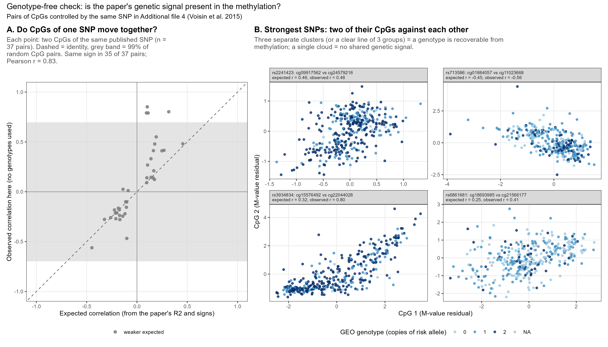

```{r setup, include = FALSE}
knitr::opts_knit$set(root.dir = normalizePath(".."))
knitr::opts_chunk$set(echo = TRUE, comment = "#>")
```

**Slides:** 9 (coherence of the paper's pairs); backup 21 (the maths).

Report 2 found almost no genetic signal. Either the methylation data are wrong, or the
genotypes are not linked to the right people. This check uses **no genotypes at all**.

**Idea is:** In the paper (Additional file 4) one SNP often controls several CpGs, each with a
known effect sign and R² (share of the CpG's variance explained by the SNP). If CpG₁ and CpG₂
both depend on the same genotype G, plus independent noise,

  CpG₁ = a·G + noise₁, CpG₂ = b·G + noise₂,

then the only thing they share is G, so their correlation across people is the product of
their correlations with G:

  expected r(CpG₁, CpG₂) = sign(a·b) · √R²₁ · √R²₂.

If the methylation is correct, the observed correlations between such CpGs must follow these
expected values, whatever is wrong with the genotypes.

```{r packages}
source("R/functions.R")
need_objects(c("pheno", "mvals_full", "dosage_mat"), "analysis/01 and 02")
```

## Settings

```{r settings}
COH_MIN_R2 <- 8      # a CpG is used if the SNP explains at least 8 % of its variance in the paper
COH_SEED   <- 11
COH_N_NULL <- 2000   # random CpGs for the null distribution of correlations
N_SCATTER  <- 4      # SNPs shown in panel B of the figure
set.seed(COH_SEED)
```

## CpG pairs of the same SNP

The 107 significant SNP–CpG pairs of the paper's Additional file 4 are stored in
`data/voisin2015_additional_file4_pairs.csv` (columns: SNP, CpG, effect `coef`, `r2_pct`, p, q).
Only CpGs with R² ≥ 8 % are used (smaller R² gives expected correlations too small to see),
and only SNPs with at least two such CpGs.

The observed correlation is computed on the M-values **after removing sex, age and
cellPC1/2** (residuals of a linear model), so that it is not driven by these factors.

```{r pairs}
paper_pairs <- read.csv("data/voisin2015_additional_file4_pairs.csv", stringsAsFactors = FALSE)
paper_pairs <- paper_pairs[paper_pairs$cpg %in% rownames(mvals_full) & paper_pairs$r2_pct >= COH_MIN_R2, ]
cpgs_per_snp <- table(paper_pairs$snp)
paper_pairs <- paper_pairs[paper_pairs$snp %in% names(cpgs_per_snp)[cpgs_per_snp >= 2], ]

# residuals of the M-values after sex, age and cell composition (rows = CpGs)
cov_coh <- data.frame(Sex = as.numeric(pheno$Sex) - 1, Age = pheno$age,
                      cellPC1 = pheno$cellPC1, cellPC2 = pheno$cellPC2)
qr_coh <- qr(cbind(1, as.matrix(cov_coh)))
adjust_for_covariates <- function(M) t(qr.resid(qr_coh, t(M)))
R <- adjust_for_covariates(mvals_full[unique(paper_pairs$cpg), pheno$sample_id])

pairs <- data.frame()
for (snp in sort(unique(paper_pairs$snp))) {
  d <- paper_pairs[paper_pairs$snp == snp, ]
  for (i in 1:(nrow(d) - 1)) {
    for (j in (i + 1):nrow(d)) {
      pairs <- rbind(pairs, data.frame(
        snp = snp, cpg1 = d$cpg[i], cpg2 = d$cpg[j],
        exp_r = sign(d$coef[i] * d$coef[j]) * sqrt(d$r2_pct[i] * d$r2_pct[j]) / 100,
        obs_r = cor(R[d$cpg[i], ], R[d$cpg[j], ]),
        stringsAsFactors = FALSE))
    }
  }
}
```

## How large are correlations between random CpGs?

Neighbouring or co-regulated CpGs can correlate for reasons unrelated to any SNP. As a
reference, the correlations between all pairs of 2,000 random CpGs (same adjustment) are
computed; 99 % of them have |r| below `q99`. This band is conservative: an expected
correlation must exceed it to count as "strong". Only three CpGs managed to exceed this threshold, but the most significant thing in this analysis is the sign match, which is true for almost all pairs. 

```{r null}
random_cpgs <- sample(rownames(mvals_full), min(COH_N_NULL, nrow(mvals_full)))
R_null <- adjust_for_covariates(mvals_full[random_cpgs, pheno$sample_id])
cor_null <- cor(t(R_null))
null_r <- cor_null[upper.tri(cor_null)]
q99 <- unname(quantile(abs(null_r), 0.99))

pairs$strong_expected <- abs(pairs$exp_r) > q99
pairs$agree <- sign(pairs$exp_r) == sign(pairs$obs_r) & abs(pairs$obs_r) > q99
write.csv(pairs, result_path("cpg_coherence_pairs.csv"), row.names = FALSE)

n_same_sign <- sum(sign(pairs$exp_r) == sign(pairs$obs_r))
r_exp_obs <- cor(pairs$exp_r, pairs$obs_r)
cat(sprintf("CpG pairs of the same SNP: %d; 99%% quantile of |r| between random CpGs: %.2f\n", nrow(pairs), q99))
cat(sprintf("Same sign (expected vs observed r): %d of %d pairs; Pearson r = %.2f\n",
            n_same_sign, nrow(pairs), r_exp_obs))
head(pairs[order(-abs(pairs$exp_r)), ], 10)
```

## Figure for slide 9

- **A.** Each point is one CpG pair: expected correlation (x) against observed correlation
  (y). Points near the dashed identity line, on the expected side of zero, mean the paper's
  genetic signal is present in this methylation.
- **B.** For the strongest SNPs: the two CpGs plotted against each other, coloured by the GEO
  genotype. If the genotypes were correct, the colours would form separate groups along the
  line; mixed colours mean the genotype labels do not belong to these people.

```{r fig08-coherence}
pA <- ggplot(pairs, aes(exp_r, obs_r)) +
  annotate("rect", xmin = -Inf, xmax = Inf, ymin = -q99, ymax = q99, fill = "grey85", alpha = 0.7) +
  geom_hline(yintercept = 0, colour = "grey60") +
  geom_vline(xintercept = 0, colour = "grey60") +
  geom_abline(slope = 1, intercept = 0, colour = "grey40", linetype = "dashed") +
  geom_point(aes(colour = strong_expected), size = 2, alpha = 0.85) +
  scale_colour_manual(values = c(`TRUE` = "#D55E00", `FALSE` = "grey50"), name = NULL,
                      labels = c(`TRUE` = "expected |r| above random-pair level", `FALSE` = "weaker expected")) +
  coord_cartesian(xlim = c(-1, 1), ylim = c(-1, 1)) +
  labs(title = "A. Do CpGs of one SNP move together?",
       subtitle = wrap_text(sprintf("Each point: two CpGs of the same published SNP (n = %d pairs). Dashed = identity, grey band = 99%% of random CpG pairs. Same sign in %d of %d pairs; Pearson r = %.2f.",
                                    nrow(pairs), n_same_sign, nrow(pairs), r_exp_obs), 52),
       x = "Expected correlation (from the paper's R2 and signs)", y = "Observed correlation here (no genotypes used)") +
  theme_gse() + theme(legend.position = "bottom", plot.title.position = "plot")

top <- head(pairs[order(-abs(pairs$exp_r)), ], 40)
top <- head(top[!duplicated(top$snp), ], N_SCATTER)     # the strongest pair of each of the top SNPs
scatter <- data.frame()
for (i in 1:nrow(top)) {
  g <- dosage_mat[pheno$sample_id, top$snp[i]]
  scatter <- rbind(scatter, data.frame(
    panel = sprintf("%s: %s vs %s\nexpected r = %.2f, observed r = %.2f",
                    top$snp[i], top$cpg1[i], top$cpg2[i], top$exp_r[i], top$obs_r[i]),
    x = R[top$cpg1[i], ], y = R[top$cpg2[i], ],
    geno = factor(g, levels = c(0, 1, 2))))
}
scatter$panel <- factor(scatter$panel, levels = unique(scatter$panel))
pB <- ggplot(scatter, aes(x, y, colour = geno)) +
  geom_point(size = 1.4, alpha = 0.8) +
  facet_wrap(~panel, scales = "free", ncol = 2) +
  scale_colour_manual(values = PAL_GENO, na.value = "grey75", name = "GEO genotype (copies of risk allele)") +
  labs(title = "B. Strongest SNPs: two of their CpGs against each other",
       subtitle = wrap_text("Three separate clusters (or a clear line of 3 groups) = a genotype is recoverable from methylation; a single cloud = no shared genetic signal.", 90),
       x = "CpG 1 (M-value residual)", y = "CpG 2 (M-value residual)") +
  theme_gse() + theme(legend.position = "bottom", strip.text = element_text(size = 7.5, hjust = 0),
                      plot.title.position = "plot")

p_coherence <- (pA | pB) + plot_layout(widths = c(1, 1.5)) +
  plot_annotation(title = "Genotype-free check: is the paper's genetic signal present in the methylation?",
                  subtitle = "Pairs of CpGs controlled by the same SNP in Additional file 4 (Voisin et al. 2015)")
save_fig(p_coherence, "08_cpg_coherence", width = 14, height = 8)
```


