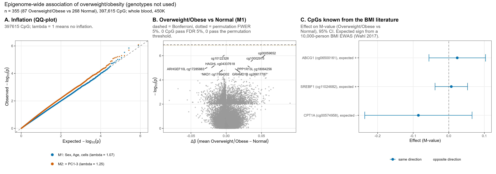

```{r setup, include = FALSE}
knitr::opts_knit$set(root.dir = normalizePath(".."))
knitr::opts_chunk$set(echo = TRUE, comment = "#>")
```

**Slide:** 10 (EWAS).

Because the GEO genotypes are not linked to the right people (reports 2–3), the rest of the
project is genotype-free. An **epigenome-wide association study (EWAS)** tests every one
of the 397,615 CpGs separately for a difference between two groups:
Overweight + Obese (n = 87) versus Normal-weight (n = 268). The two heavier groups are merged
because there are only 17 Obese people which leads to extreme class unbalance.

```{r packages}
source("R/functions.R")
need_objects(c("pheno", "beta_mat", "mvals_full", "pca", "anno"), "analysis/01_data_pca_umap.Rmd")
```

## Settings

```{r settings}
EW_SEED      <- 20261009
N_PERM_EWAS  <- 200     # label permutations for the permutation (FWER) threshold
N_TOP_SAVE   <- 20000   # number of top CpGs written to results/ewas_top_cpgs.csv
N_LABEL_EWAS <- 8       # labelled CpGs in the volcano plot
set.seed(EW_SEED)
```

## Models

For each CpG, a linear model of its M-value:

- **M1** (main): `M ~ group + Sex + Age + cellPC1 + cellPC2`, group = 1 for Overweight/Obese,
  0 for Normal-weight;
- **M2** (sensitivity): M1 + methylation PC1–PC3 (from report 1), which absorb large unknown
  sources of variation (possible batch effects) but may also remove real signal.

The fitting uses `ols_scan()` from `R/functions.R`: the same least-squares estimate, standard
error, t and p as `lm()`, but for all CpGs at once. It is checked against `lm()` on 15 random
CpGs per model.

**Multiple testing.** With 397,615 tests, about 20,000 CpGs have p < 0.05 by chance alone.
Three corrections are used:

- **BH-FDR** (false discovery rate): among the CpGs called significant, on average at most
  5 % are false;
- **Bonferroni** (family-wise error rate, FWER): the probability of even one false positive
  among all tests is at most 5 %; threshold p < 0.05 / 397,615 = 1.26·10⁻⁷;(It appears to be       overly strict. However, that is hardly the reason for the virtually zero results.)
- **permutation FWER**: the group labels are shuffled 200 times; each time the largest |t| over
  all CpGs is recorded. The 95th percentile of these 200 maxima is a threshold that only 5 %
  of label-free datasets exceed anywhere in the genome. Unlike Bonferroni it accounts for the
  correlation between CpGs.

```{r fit}
group <- as.integer(pheno$weight.category %in% c("Overweight", "Obese"))
cat(sprintf("n = %d (Overweight+Obese %d, Normal %d), CpGs: %s\n",
            length(group), sum(group), sum(1 - group), format(nrow(mvals_full), big.mark = ",")))
cov_m1 <- data.frame(Sex = as.numeric(pheno$Sex) - 1, Age = pheno$age,
                     cellPC1 = pheno$cellPC1, cellPC2 = pheno$cellPC2)
cov_m2 <- cbind(cov_m1, pca$x[match(pheno$sample_id, rownames(pca$x)), 1:3])

# 200 shuffled versions of the group labels (one per column)
perm_labels <- matrix(NA_real_, length(group), N_PERM_EWAS)
for (b in 1:N_PERM_EWAS) perm_labels[, b] <- sample(group)

r1 <- ols_scan(mvals_full, group, cov_m1, y_perm = perm_labels)
check_scan_with_lm(r1, mvals_full, group, cov_m1, rows = sample(nrow(mvals_full), 15))
r2 <- ols_scan(mvals_full, group, cov_m2)
check_scan_with_lm(r2, mvals_full, group, cov_m2, rows = sample(nrow(mvals_full), 15))
```

## Results

**λ** (genomic inflation) compares the median test statistic with its value under the null:
λ ≈ 1 means the p-values as a whole behave as expected with no effects; λ > 1 means inflation.

```{r summary}
r1$q <- p.adjust(r1$p, "BH")
r2$q <- p.adjust(r2$p, "BH")
p_bonf <- 0.05 / nrow(mvals_full)
perm_t_thr <- as.numeric(quantile(r1$max_abs_t_perm, 0.95))     # |t| threshold at 5 % FWER
p_perm_thr <- 2 * pt(-perm_t_thr, r1$df)                         # the same threshold as a p-value
lam1 <- lambda_gc(r1$p)
lam2 <- lambda_gc(r2$p)

ewas_summary <- data.frame(
  model = c("M1 (Sex, Age, cellPC1-2)", "M2 (+ PC1-3)"),
  lambda = c(lam1, lam2),
  n_fdr05 = c(sum(r1$q < 0.05), sum(r2$q < 0.05)),
  n_bonferroni = c(sum(r1$p < p_bonf), sum(r2$p < p_bonf)),
  n_p1e5 = c(sum(r1$p < 1e-5), sum(r2$p < 1e-5)),
  n_p1e7 = c(sum(r1$p < 1e-7), sum(r2$p < 1e-7)),
  n_perm_fwer05 = c(sum(r1$p < p_perm_thr), NA))
write.csv(ewas_summary, result_path("ewas_summary.csv"), row.names = FALSE)
ewas_summary
cat(sprintf("Bonferroni: p < %.2e; permutation FWER 5%% threshold (M1): p < %.2e (|t| > %.2f)\n",
            p_bonf, p_perm_thr, perm_t_thr))
cat(sprintf("Expected by chance at p < 1e-5: %.1f CpGs\n", 1e-5 * nrow(mvals_full)))
```

The table of top CpGs adds the annotation and the raw difference in mean beta
(Δβ = mean of Overweight/Obese − mean of Normal-weight).

```{r top-table}
ai <- match(rownames(mvals_full), rownames(anno))
delta_beta <- rowMeans(beta_mat[, group == 1]) - rowMeans(beta_mat[, group == 0])
ewas_tab <- data.frame(cpg = rownames(mvals_full), chr = anno$chr[ai], pos = anno$pos[ai],
                       gene = short_gene_names(anno$UCSC_RefGene_Name[ai]),
                       island_relation = anno$Relation_to_Island[ai],
                       delta_beta = delta_beta, beta_M1 = r1$est, se_M1 = r1$se, p_M1 = r1$p, q_M1 = r1$q,
                       beta_M2 = r2$est, p_M2 = r2$p, q_M2 = r2$q, stringsAsFactors = FALSE)
ewas_tab <- ewas_tab[order(ewas_tab$p_M1), ]
write.csv(head(ewas_tab, N_TOP_SAVE), result_path("ewas_top_cpgs.csv"), row.names = FALSE)
head(ewas_tab[, c("cpg", "gene", "chr", "delta_beta", "p_M1", "q_M1", "p_M2")], 15)
```

## CpGs known from the BMI literature (control of the direction)

Large blood EWAS of BMI (Wahl et al. 2017, *Nature* 541:81, n ≈ 10,000; Supplementary Table 3)
found CpGs whose methylation rises (+) or falls (−) with BMI. If our labels and data are
correct, our group effects should at least point the same way. The 4-CpG version of this check
(slide 8) is in report 5.

```{r known-bmi}
known_bmi <- data.frame(cpg = c("cg06500161", "cg00574958", "cg11024682"),
                        gene = c("ABCG1", "CPT1A", "SREBF1"),
                        expected_sign = c(1, -1, 1), stringsAsFactors = FALSE)
kn <- merge(known_bmi, ewas_tab[, c("cpg", "beta_M1", "se_M1", "p_M1", "delta_beta")], by = "cpg")
kn$direction_matches <- sign(kn$beta_M1) == kn$expected_sign
write.csv(kn, result_path("ewas_known_bmi_cpgs.csv"), row.names = FALSE)
kn
```

## Figure for slide 10

- **A. QQ plot:** sorted observed −log₁₀ p against the values expected if no CpG had any
  effect. Points on the diagonal = no signal.
- **B. Volcano plot:** effect size (Δβ) against significance. Dashed line = Bonferroni,
  dotted line = permutation FWER threshold.
- **C.** The three literature CpGs with 95 % confidence intervals.

```{r fig09-ewas}
PAL_MODEL <- c(M1 = "#0072B2", M2 = "#D55E00")

# QQ plot: all of the 2,000 smallest p-values plus 15,000 evenly spaced ranks (enough to draw the curve)
qq_points <- function(p, model) {
  p <- sort(p)
  N <- length(p)
  idx <- unique(c(1:min(2000, N), round(seq(1, N, length.out = 15000))))
  data.frame(exp = -log10((idx - 0.5) / N), obs = -log10(p[idx]), model = model)
}
qq <- rbind(qq_points(r1$p, "M1"), qq_points(r2$p, "M2"))
lim <- max(qq$exp, qq$obs)
pA <- ggplot(qq, aes(exp, obs, colour = model)) +
  geom_abline(slope = 1, intercept = 0, colour = "grey50", linetype = "dashed") +
  geom_point(size = 0.7, alpha = 0.8) +
  scale_colour_manual(values = PAL_MODEL,
                      labels = c(M1 = sprintf("M1: Sex, Age, cells (lambda = %.2f)", lam1),
                                 M2 = sprintf("M2: + PC1-3 (lambda = %.2f)", lam2)), name = NULL,
                      guide = guide_legend(ncol = 1, override.aes = list(size = 2.5, alpha = 1))) +
  coord_cartesian(xlim = c(0, lim), ylim = c(0, lim)) +
  labs(title = "A. Inflation (QQ-plot)",
       subtitle = wrap_text(sprintf("%d CpG; lambda = 1 means no inflation.", nrow(mvals_full)), 50),
       x = expression(Expected~-log[10](p)), y = expression(Observed~-log[10](p))) +
  theme_left() + theme(legend.position = "bottom")

# Volcano: all CpGs with p < 0.01 plus a random 40,000 of the rest (drawing 397,615 points is slow)
vol <- ewas_tab
vol$nlp <- -log10(vol$p_M1)
random_rows <- sample(nrow(vol), min(40000, nrow(vol)))
keep <- vol$nlp > 2 | 1:nrow(vol) %in% random_rows
vol_points <- vol[keep, ]
top_lab <- head(vol, N_LABEL_EWAS)
top_lab$lab <- ifelse(top_lab$gene != "", paste0(sub(";.*", "", top_lab$gene), " ", top_lab$cpg), top_lab$cpg)
pB <- ggplot(vol_points, aes(delta_beta, nlp)) +
  geom_hline(yintercept = -log10(p_bonf), colour = "grey30", linetype = "dashed") +
  geom_hline(yintercept = -log10(p_perm_thr), colour = "#D55E00", linetype = "dotted") +
  geom_point(colour = "grey60", size = 0.6, alpha = 0.6) +
  geom_point(data = vol_points[vol_points$p_M1 < p_perm_thr, ], colour = "#0072B2", size = 1.2) +
  geom_text_repel(data = top_lab, aes(label = lab), size = 2.8, min.segment.length = 0.1, max.overlaps = Inf) +
  labs(title = "B. Overweight/Obese vs Normal (M1)",
       subtitle = wrap_text(sprintf("dashed = Bonferroni, dotted = permutation FWER 5%%. %d CpG pass FDR 5%%, %d pass the permutation threshold.",
                                    ewas_summary$n_fdr05[1], ewas_summary$n_perm_fwer05[1]), 50),
       x = expression(Delta*beta~(mean~Overweight/Obese - Normal)), y = expression(-log[10](p))) +
  theme_left()

kn$lo <- kn$beta_M1 - 1.96 * kn$se_M1
kn$hi <- kn$beta_M1 + 1.96 * kn$se_M1
kn$lab <- sprintf("%s (%s), expected %s", kn$gene, kn$cpg, ifelse(kn$expected_sign > 0, "+", "-"))
kn$ok <- factor(ifelse(kn$direction_matches, "same direction", "opposite direction"),
                levels = c("same direction", "opposite direction"))
pC <- ggplot(kn, aes(beta_M1, reorder(lab, beta_M1), colour = ok)) +
  geom_vline(xintercept = 0, colour = "grey50", linetype = "dashed") +
  geom_errorbar(aes(xmin = lo, xmax = hi), width = 0.25, orientation = "y") +
  geom_point(size = 2.4) +
  scale_colour_manual(values = c("same direction" = "#0072B2", "opposite direction" = "#D55E00"),
                      drop = FALSE, name = NULL) +
  labs(title = "C. CpGs known from the BMI literature",
       subtitle = wrap_text("Effect on M-value (Overweight/Obese vs Normal), 95% CI. Expected sign from a 10,000-person BMI EWAS (Wahl 2017).", 46),
       x = "Effect (M-value)", y = NULL) +
  theme_left() + theme(legend.position = "bottom")

p_ewas <- (pA | pB | pC) + plot_annotation(
  title = "Epigenome-wide association of overweight/obesity (genotypes not used)",
  subtitle = sprintf("n = %d (%d Overweight/Obese vs %d Normal), %s CpG; whole blood, 450K",
                     length(group), sum(group), sum(1 - group), format(nrow(mvals_full), big.mark = ",")))
save_fig(p_ewas, "09_ewas", width = 17, height = 6)
```


