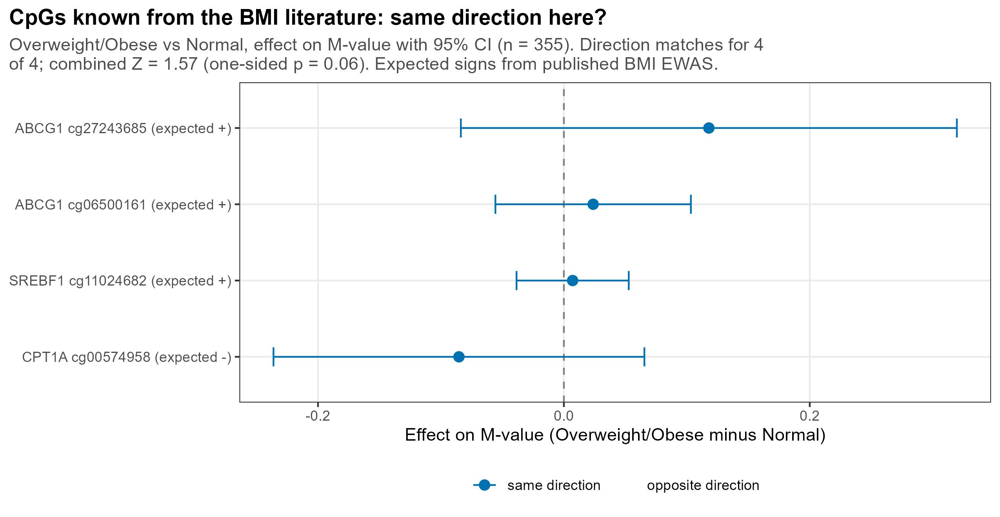
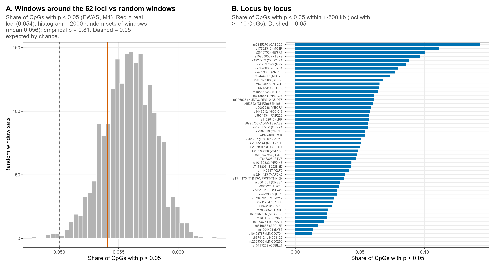
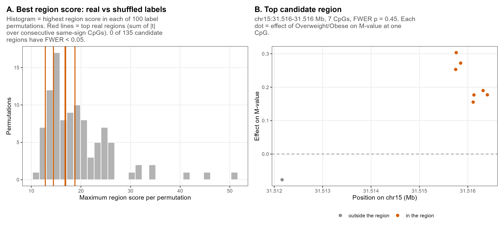
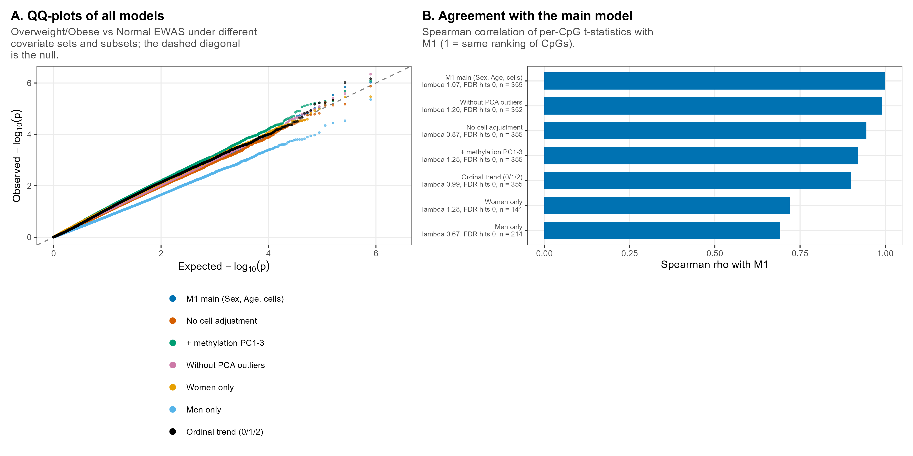
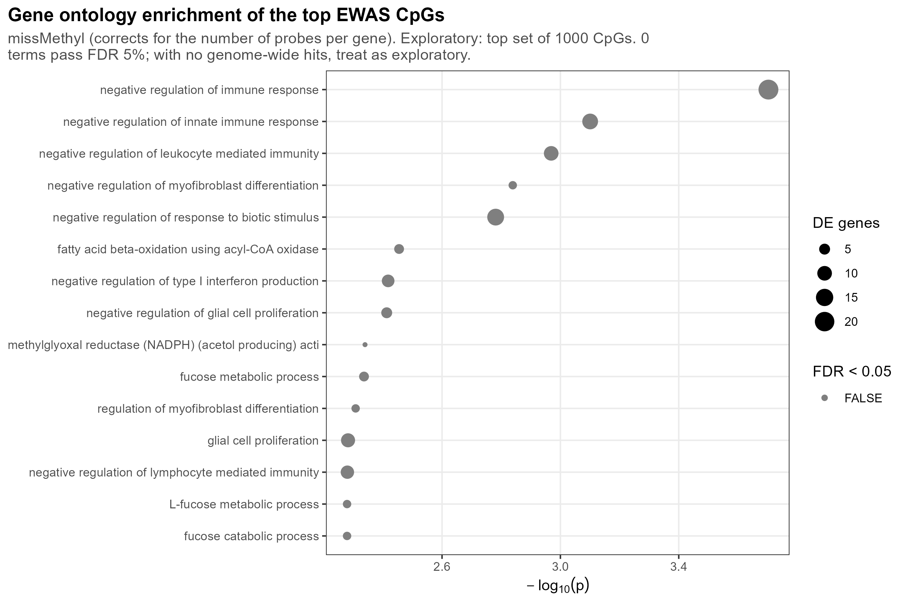

```{r setup, include = FALSE}
knitr::opts_knit$set(root.dir = normalizePath(".."))
knitr::opts_chunk$set(echo = TRUE, comment = "#>")
```

**Slides:** 8 (known BMI CpGs), 13 (summary table); backup 22 (EWAS sensitivity),
24 (obesity loci), 25 (DMR scan), 26 (GO enrichment).

The EWAS of report 4 found no single significant CpG. This report asks whether a weaker or
more spread-out signal is there: at CpGs already known to change with BMI, around the 52
obesity loci, in regions of neighbouring CpGs, or in biological pathways; and whether the
null result depends on the model. No genotypes are used (only the SNP *positions*).

```{r packages}
source("R/functions.R")
need_objects(c("pheno", "beta_mat", "mvals_full", "pca", "anno", "outlier_ids", "snp_tab"),
             "analysis/01 and 02")
```

## Settings

```{r settings}
GF_SEED     <- 20261010
N_PERM_DMR  <- 100      # label permutations for the DMR threshold
DMR_T_THR   <- 2        # a CpG is a region candidate if |t| > 2
DMR_MIN_CPG <- 3        # minimum number of neighbouring same-sign CpGs in a region
DMR_MAX_GAP <- 1000     # bp: a larger gap between CpGs starts a new cluster
N_RAND_LOCI <- 2000     # random window sets in the locus enrichment test
ENR_TOP_N   <- 1000     # CpGs tested for GO enrichment when there are no FDR hits
PAL7 <- c("#0072B2", "#D55E00", "#009E73", "#CC79A7", "#E69F00", "#56B4E9", "#000000")
set.seed(GF_SEED)
```

## Main EWAS model again, with permuted labels for the DMR scan

The main model M1 of report 4 (`M ~ group + Sex + Age + cellPC1 + cellPC2`) is fitted again,
together with 100 shuffled versions of the group labels. The t-statistics of the shuffled
labels are kept for every CpG: the DMR scan below needs them.

```{r m1}
group <- as.integer(pheno$weight.category %in% c("Overweight", "Obese"))
sex_num <- as.numeric(pheno$Sex) - 1
cov_m1 <- data.frame(Sex = sex_num, Age = pheno$age, cellPC1 = pheno$cellPC1, cellPC2 = pheno$cellPC2)

perm_labels <- matrix(NA_real_, length(group), N_PERM_DMR)
for (b in 1:N_PERM_DMR) perm_labels[, b] <- sample(group)

r_m1 <- ols_scan(mvals_full, group, cov_m1, y_perm = perm_labels, keep_perm_t = TRUE)
r_m1$q <- p.adjust(r_m1$p, "BH")
check_scan_with_lm(r_m1, mvals_full, group, cov_m1, rows = sample(nrow(mvals_full), 10))
cat(sprintf("M1: lambda = %.3f, CpGs with FDR < 0.05: %d\n", lambda_gc(r_m1$p), sum(r_m1$q < 0.05)))
```

Positions of all CpGs on one genome-wide axis (chromosome × 10⁹ + position), so that windows
and neighbours can be found by sorting:

```{r positions}
chromosome_number <- function(chr) {
  x <- sub("^chr", "", chr)
  x[x == "X"] <- "23"
  x[x == "Y"] <- "24"
  suppressWarnings(as.integer(x))
}
cpg <- rownames(mvals_full)
ai <- match(cpg, rownames(anno))
cpg_chr <- anno$chr[ai]
cpg_chr_num <- chromosome_number(cpg_chr)
cpg_pos_bp <- as.numeric(anno$pos[ai])
cpg_gpos <- cpg_chr_num * 1e9 + cpg_pos_bp
cpg_gene <- short_gene_names(anno$UCSC_RefGene_Name[ai])
```

## 1. CpGs known from BMI studies (slide 8)

Four CpGs with a well-replicated BMI association in blood (Wahl et al. 2017, Supplementary
Table 3): methylation at ABCG1 (2 CpGs) and SREBF1 rises with BMI, at CPT1A it falls.

The four t-statistics are combined with **Stouffer's method**. The logic is as follows: if there is no actual effect, the results should be randomly scattered in both directions and, when combined, cancel each other out. If an effect does exist—even a small one—all the results will be slightly shifted in the same direction, and they will accumulate when added together. 
Z = Σ(tᵢ · expected signᵢ) / √4.
Under the null Z ~ N(0, 1); one-sided p = P(N(0, 1) > Z). The two ABCG1 CpGs are correlated,
so this p-value is approximate (too small rather than too large).

```{r known-bmi}
known <- data.frame(cpg = c("cg06500161", "cg27243685", "cg11024682", "cg00574958"),
                    gene = c("ABCG1", "ABCG1", "SREBF1", "CPT1A"),
                    expected_sign = c(1, 1, 1, -1), stringsAsFactors = FALSE)
ki <- match(known$cpg, cpg)
kn <- data.frame(known, present = !is.na(ki))
kn <- kn[kn$present, ]
ki <- ki[!is.na(ki)]
kn$beta <- r_m1$est[ki]
kn$se <- r_m1$se[ki]
kn$t <- r_m1$t[ki]
kn$p <- r_m1$p[ki]
kn$same_dir <- sign(kn$beta) == kn$expected_sign
write.csv(kn, result_path("gf_known_bmi_cpgs.csv"), row.names = FALSE)

k_same <- sum(kn$same_dir)
z_comb <- sum(kn$t * kn$expected_sign) / sqrt(nrow(kn))
p_comb <- pnorm(-z_comb)
cat(sprintf("Same direction: %d of %d; Stouffer Z = %.2f, one-sided p = %.3f\n", k_same, nrow(kn), z_comb, p_comb))
kn
```

```{r fig10-known}
kn$lo <- kn$beta - 1.96 * kn$se
kn$hi <- kn$beta + 1.96 * kn$se
kn$lab <- sprintf("%s %s (expected %s)", kn$gene, kn$cpg, ifelse(kn$expected_sign > 0, "+", "-"))
kn$ok <- factor(ifelse(kn$same_dir, "same direction", "opposite direction"),
                levels = c("same direction", "opposite direction"))
p_text <- ifelse(p_comb < 0.01, formatC(p_comb, format = "e", digits = 1), formatC(p_comb, format = "f", digits = 2))
p_known <- ggplot(kn, aes(beta, reorder(lab, beta), colour = ok)) +
  geom_vline(xintercept = 0, colour = "grey50", linetype = "dashed") +
  geom_errorbar(aes(xmin = lo, xmax = hi), width = 0.25, orientation = "y") +
  geom_point(size = 2.6) +
  scale_colour_manual(values = c("same direction" = "#0072B2", "opposite direction" = "#D55E00"),
                      drop = FALSE, name = NULL) +
  labs(title = "CpGs known from the BMI literature: same direction here?",
       subtitle = wrap_text(sprintf("Overweight/Obese vs Normal, effect on M-value with 95%% CI (n = %d). Direction matches for %d of %d; combined Z = %.2f (one-sided p = %s). Expected signs from published BMI EWAS.",
                                    length(group), k_same, nrow(kn), z_comb, p_text), 80),
       x = "Effect on M-value (Overweight/Obese minus Normal)", y = NULL) +
  theme_left() + theme(legend.position = "bottom")
save_fig(p_known, "10_known_bmi_cpgs", width = 8.5, height = 3 + 0.35 * nrow(kn))
```



## 2. Is the EWAS signal stronger around the 52 obesity loci? (backup slide 24)

If the obesity SNPs acted through nearby methylation, CpGs within ±500 kb of them should have
small EWAS p-values more often than CpGs elsewhere.

- Statistic: the share of CpGs with EWAS p < 0.05 among all CpGs inside the 52 windows
  (overlapping windows are merged, so no CpG is counted twice).
- Null distribution: the same statistic for 2,000 sets of 52 windows centred on random CpGs.
- Empirical p = (1 + number of random sets with a share ≥ observed) / (1 + 2,000).

The test is run for windows of ±50 kb, ±500 kb (main, as in the meQTL analysis) and ±1 Mb.

```{r loci}
# CpGs sorted by genome position; sig = 1 if EWAS p < 0.05
sorted <- which(!is.na(cpg_gpos))
sorted <- sorted[order(cpg_gpos[sorted])]
gpos_sorted <- cpg_gpos[sorted]
sig_sorted <- as.numeric(r_m1$p[sorted] < 0.05)
p_sorted <- r_m1$p[sorted]

# CpGs inside the window [centre - W, centre + W]: indexes first..last of the sorted positions
window_first <- function(centres, W) findInterval(centres - W, gpos_sorted, left.open = TRUE) + 1
window_last  <- function(centres, W) findInterval(centres + W, gpos_sorted)

# share of CpGs with p < 0.05 in the union of all windows
window_stat <- function(centres, W) {
  first <- window_first(centres, W)
  last <- window_last(centres, W)
  in_window <- rep(FALSE, length(gpos_sorted))
  for (k in seq_along(centres)) {
    if (last[k] >= first[k]) in_window[first[k]:last[k]] <- TRUE
  }
  n_cpg <- sum(in_window)
  c(frac = sum(sig_sorted[in_window]) / n_cpg, n_cpg = n_cpg)
}

snp_gpos <- chromosome_number(snp_tab$chr) * 1e9 + as.numeric(snp_tab$pos)
W_MAIN <- 5e5
enrichment <- data.frame()
for (W in c(5e4, 5e5, 1e6)) {
  observed_stat <- window_stat(snp_gpos, W)
  null_frac <- numeric(N_RAND_LOCI)
  for (i in 1:N_RAND_LOCI) {
    random_centres <- sample(gpos_sorted, length(snp_gpos))
    null_frac[i] <- window_stat(random_centres, W)[["frac"]]
  }
  enrichment <- rbind(enrichment, data.frame(
    window_bp = W, n_loci = length(snp_gpos), n_cpg_in_windows = observed_stat[["n_cpg"]],
    frac_p05_observed = observed_stat[["frac"]], frac_p05_random_mean = mean(null_frac),
    p_empirical_frac = (1 + sum(null_frac >= observed_stat[["frac"]])) / (1 + N_RAND_LOCI)))
  if (W == W_MAIN) null_main <- null_frac
}
write.csv(enrichment, result_path("gf_locus_enrichment.csv"), row.names = FALSE)
enrichment
```

The same share for each locus separately (±500 kb):

```{r loci-by-locus}
first <- window_first(snp_gpos, W_MAIN)
last <- window_last(snp_gpos, W_MAIN)
by_locus <- data.frame(snp = snp_tab$snp, gene = snp_tab$gene, n_cpg = pmax(0, last - first + 1),
                       frac_p05 = NA_real_, min_p = NA_real_)
for (k in 1:nrow(by_locus)) {
  if (by_locus$n_cpg[k] > 0) {
    by_locus$frac_p05[k] <- sum(sig_sorted[first[k]:last[k]]) / by_locus$n_cpg[k]
    by_locus$min_p[k] <- min(p_sorted[first[k]:last[k]])
  }
}
write.csv(by_locus, result_path("gf_locus_enrichment_by_locus.csv"), row.names = FALSE)
head(by_locus[order(-by_locus$frac_p05), ], 5)
```

```{r fig11-loci}
em <- enrichment[enrichment$window_bp == W_MAIN, ]
loc_plot <- by_locus[!is.na(by_locus$frac_p05) & by_locus$n_cpg >= 10, ]
loc_plot$lab <- paste0(loc_plot$snp, ifelse(loc_plot$gene != "", paste0(" (", loc_plot$gene, ")"), ""))
pA <- ggplot(data.frame(v = null_main), aes(v)) +
  geom_histogram(bins = 40, fill = "grey70", colour = "white") +
  geom_vline(xintercept = em$frac_p05_observed, colour = "#D55E00", linewidth = 1) +
  geom_vline(xintercept = 0.05, colour = "grey30", linetype = "dashed") +
  labs(title = "A. Windows around the 52 loci vs random windows",
       subtitle = wrap_text(sprintf("Share of CpGs with p < 0.05 (EWAS, M1). Red = real loci (%.3f), histogram = %d random sets of windows (mean %.3f); empirical p = %.2f. Dashed = 0.05 expected by chance.",
                                    em$frac_p05_observed, N_RAND_LOCI, em$frac_p05_random_mean, em$p_empirical_frac), 55),
       x = "Share of CpGs with p < 0.05", y = "Random window sets") +
  theme_left()
pB <- ggplot(loc_plot, aes(frac_p05, reorder(lab, frac_p05))) +
  geom_vline(xintercept = 0.05, colour = "grey30", linetype = "dashed") +
  geom_col(fill = "#0072B2", width = 0.7) +
  labs(title = "B. Locus by locus",
       subtitle = wrap_text(sprintf("Share of CpGs with p < 0.05 within +-%d kb (loci with >= 10 CpGs). Dashed = 0.05.", W_MAIN / 1000), 55),
       x = "Share of CpGs with p < 0.05", y = NULL) +
  theme_left() + theme(axis.text.y = element_text(size = 6))
save_fig(pA | pB, "11_locus_enrichment", width = 13, height = 7)
```



## 3. Differentially methylated regions (backup slide 25)

A real effect may be spread over several neighbouring CpGs, each too weak alone.

- **Region:** at least 3 neighbouring CpGs (gaps ≤ 1 kb) whose t-statistics all exceed 2 in
  the same direction. The t-statistic is the effect divided by its standard error; |t| > 2
  roughly means "nominal p < 0.05" for one CpG.
- **Score** of a region: the sum of |t| over its CpGs.
- **FWER p-value:** in each of the 100 label permutations the best (highest) region score in
  the whole genome is recorded. A real region's p = (1 + number of permutations whose best
  score ≥ its score) / (1 + 100). This corrects for searching the whole genome.

```{r dmr}
# CpGs in genome order, split into clusters wherever the gap to the previous CpG is > 1 kb
dmr_order <- which(!is.na(cpg_gpos))
dmr_order <- dmr_order[order(cpg_gpos[dmr_order])]
cluster_id <- cumsum(c(TRUE, diff(cpg_gpos[dmr_order]) > DMR_MAX_GAP))

# t: t-statistics in dmr_order. Returns one row per region (s, e = first/last position in dmr_order).
find_regions <- function(t) {
  direction <- rep(0, length(t))
  direction[!is.na(t) & t > DMR_T_THR] <- 1
  direction[!is.na(t) & t < -DMR_T_THR] <- -1
  # a run = consecutive CpGs of the same cluster with the same direction
  runs <- rle(paste(cluster_id, direction))
  run_end <- cumsum(runs$lengths)
  run_start <- run_end - runs$lengths + 1
  run_direction <- direction[run_start]
  is_region <- runs$lengths >= DMR_MIN_CPG & run_direction != 0
  # score = sum of |t| from start to end, read off cumulative sums
  cum_abs_t <- c(0, cumsum(abs(ifelse(is.na(t), 0, t))))
  s <- run_start[is_region]
  e <- run_end[is_region]
  data.frame(s = s, e = e, n = runs$lengths[is_region],
             score = cum_abs_t[e + 1] - cum_abs_t[s], dir = run_direction[is_region])
}

regions <- find_regions(r_m1$t[dmr_order])
null_max <- numeric(N_PERM_DMR)
for (j in 1:N_PERM_DMR) {
  null_regions <- find_regions(r_m1$t_perm[dmr_order, j])
  null_max[j] <- if (nrow(null_regions) > 0) max(null_regions$score) else 0
}
regions$p_fwer <- NA_real_
for (k in seq_len(nrow(regions))) regions$p_fwer[k] <- (1 + sum(null_max >= regions$score[k])) / (1 + N_PERM_DMR)
regions <- regions[order(-regions$score), ]
cat(sprintf("Candidate regions: %d; FWER < 0.05: %d; score threshold (95%% of null): %.1f\n",
            nrow(regions), sum(regions$p_fwer < 0.05), as.numeric(quantile(null_max, 0.95))))
```

```{r dmr-table}
top_regions <- head(regions, 100)
dmr_tab <- data.frame()
for (k in seq_len(nrow(top_regions))) {
  ix <- dmr_order[top_regions$s[k]:top_regions$e[k]]          # CpG rows of this region
  genes <- unique(unlist(strsplit(cpg_gene[ix], ";")))
  genes <- genes[genes != ""]
  dmr_tab <- rbind(dmr_tab, data.frame(
    chr = cpg_chr[ix[1]], start = min(cpg_pos_bp[ix]), end = max(cpg_pos_bp[ix]), n_cpg = top_regions$n[k],
    score = top_regions$score[k],
    direction = ifelse(top_regions$dir[k] > 0, "hyper in Overweight/Obese", "hypo in Overweight/Obese"),
    mean_delta_beta = mean(rowMeans(beta_mat[ix, group == 1, drop = FALSE]) - rowMeans(beta_mat[ix, group == 0, drop = FALSE])),
    genes = paste(head(genes, 3), collapse = ";"),
    p_fwer = top_regions$p_fwer[k]))
}
write.csv(dmr_tab, result_path("gf_dmr_regions.csv"), row.names = FALSE)
head(dmr_tab, 8)
```

```{r fig12-dmr}
pA <- ggplot(data.frame(v = null_max), aes(v)) +
  geom_histogram(bins = 30, fill = "grey70", colour = "white") +
  geom_vline(xintercept = head(regions$score, 5), colour = "#D55E00", linewidth = 0.8) +
  labs(title = "A. Best region score: real vs shuffled labels",
       subtitle = wrap_text(sprintf("Histogram = highest region score in each of %d label permutations. Red lines = top real regions (sum of |t| over consecutive same-sign CpGs). %d of %d candidate regions have FWER < 0.05.",
                                    N_PERM_DMR, sum(regions$p_fwer < 0.05), nrow(regions)), 55),
       x = "Maximum region score per permutation", y = "Permutations") +
  theme_left()

best <- regions[1, ]
ix <- dmr_order[best$s:best$e]
best_chr <- cpg_chr_num[ix[1]]
from <- min(cpg_pos_bp[ix]) - 5000
to <- max(cpg_pos_bp[ix]) + 5000
near <- which(cpg_chr_num == best_chr & cpg_pos_bp >= from & cpg_pos_bp <= to)
d_near <- data.frame(pos = cpg_pos_bp[near], est = r_m1$est[near],
                     inreg = factor(near %in% ix, levels = c(FALSE, TRUE)))
pB <- ggplot(d_near, aes(pos / 1e6, est, colour = inreg)) +
  geom_hline(yintercept = 0, colour = "grey50", linetype = "dashed") +
  geom_point(size = 2) +
  scale_colour_manual(values = c("FALSE" = "grey55", "TRUE" = "#D55E00"),
                      labels = c("FALSE" = "outside the region", "TRUE" = "in the region"), drop = FALSE, name = NULL) +
  labs(title = "B. Top candidate region",
       subtitle = wrap_text(sprintf("chr%d:%.3f-%.3f Mb, %d CpGs, FWER p = %.2f. Each dot = effect of Overweight/Obese on M-value at one CpG.",
                                    best_chr, min(cpg_pos_bp[ix]) / 1e6, max(cpg_pos_bp[ix]) / 1e6, best$n, best$p_fwer), 55),
       x = sprintf("Position on chr%d (Mb)", best_chr), y = "Effect on M-value") +
  theme_left() + theme(legend.position = "bottom")
save_fig(pA | pB, "12_dmr_scan", width = 12, height = 5.5)

r_m1$t_perm <- NULL     # free memory: the permutation t-statistics are no longer needed
invisible(gc())
```



## 4. Does the null EWAS result depend on the model? (backup slide 22)

The main model M1 is compared with 6 variants of it (7 models in total). For each: λ, the number of FDR hits, and the
Spearman correlation of its per-CpG t-statistics with those of M1 (ρ = 1: the same ranking
of CpGs).

```{r sensitivity}
pcs3 <- pca$x[match(pheno$sample_id, rownames(pca$x)), 1:3]
is_outlier <- pheno$sample_id %in% outlier_ids
weight_012 <- pheno$weight_num
all_people <- rep(TRUE, nrow(pheno))

models <- list(
  list(name = "M1 main (Sex, Age, cells)", y = group, cov = cov_m1, keep = all_people),
  list(name = "No cell adjustment", y = group, cov = cov_m1[, c("Sex", "Age")], keep = all_people),
  list(name = "+ methylation PC1-3", y = group, cov = cbind(cov_m1, pcs3), keep = all_people),
  list(name = "Without PCA outliers", y = group, cov = cov_m1, keep = !is_outlier),
  list(name = "Women only", y = group, cov = cov_m1, keep = sex_num == 0),
  list(name = "Men only", y = group, cov = cov_m1, keep = sex_num == 1),
  list(name = "Ordinal trend (0/1/2)", y = weight_012, cov = cov_m1, keep = all_people))

scans <- list()
sensitivity <- data.frame()
for (m in models) {
  if (m$name == "M1 main (Sex, Age, cells)") {
    r <- r_m1
  } else {
    r <- ols_scan(mvals_full, m$y, m$cov, keep = m$keep)
  }
  r$q <- p.adjust(r$p, "BH")
  scans[[m$name]] <- r
  sensitivity <- rbind(sensitivity, data.frame(
    model = m$name, n = sum(m$keep), lambda = lambda_gc(r$p),
    n_fdr05 = sum(r$q < 0.05), n_p1e5 = sum(r$p < 1e-5),
    rho_t_with_M1 = cor(r$t, r_m1$t, use = "pairwise.complete.obs", method = "spearman")))
}
write.csv(sensitivity, result_path("gf_ewas_sensitivity.csv"), row.names = FALSE)
sensitivity
```

```{r fig13-sensitivity}
qq <- data.frame()
for (name in names(scans)) {
  p <- sort(scans[[name]]$p)
  N <- length(p)
  idx <- unique(c(1:min(2000, N), round(seq(1, N, length.out = 8000))))
  qq <- rbind(qq, data.frame(exp = -log10((idx - 0.5) / N), obs = -log10(p[idx]), model = name))
}
qq$model <- factor(qq$model, levels = names(scans))
lim <- max(qq$exp, qq$obs)
pA <- ggplot(qq, aes(exp, obs, colour = model)) +
  geom_abline(slope = 1, intercept = 0, colour = "grey50", linetype = "dashed") +
  geom_point(size = 0.6, alpha = 0.7) +
  scale_colour_manual(values = PAL7[seq_along(scans)], name = NULL,
                      guide = guide_legend(ncol = 1, override.aes = list(size = 2.5, alpha = 1))) +
  coord_cartesian(xlim = c(0, lim), ylim = c(0, lim)) +
  labs(title = "A. QQ-plots of all models",
       subtitle = wrap_text("Overweight/Obese vs Normal EWAS under different covariate sets and subsets; the dashed diagonal is the null.", 50),
       x = expression(Expected~-log[10](p)), y = expression(Observed~-log[10](p))) +
  theme_left() + theme(legend.position = "bottom")
sensitivity$lab <- sprintf("%s\nlambda %.2f, FDR hits %d, n = %d", sensitivity$model, sensitivity$lambda,
                           sensitivity$n_fdr05, sensitivity$n)
pB <- ggplot(sensitivity, aes(rho_t_with_M1, reorder(lab, rho_t_with_M1))) +
  geom_col(fill = "#0072B2", width = 0.7) +
  labs(title = "B. Agreement with the main model",
       subtitle = wrap_text("Spearman correlation of per-CpG t-statistics with M1 (1 = same ranking of CpGs).", 50),
       x = "Spearman rho with M1", y = NULL) +
  theme_left() + theme(axis.text.y = element_text(size = 7))
save_fig(pA | pB, "13_ewas_sensitivity", width = 13, height = 6.5)
```



## 5. Gene ontology enrichment (backup slide 26)

Do the CpGs with the smallest EWAS p-values sit in genes of particular biological processes?
`missMethyl::gometh` tests GO terms and corrects for the fact that genes covered by more
450K probes are picked more often by chance. Since there are no FDR-significant CpGs, the
1,000 CpGs with the smallest p are used (exploratory), against all tested CpGs as background.
Terms are corrected with BH-FDR.

```{r go}
sig_cpg <- cpg[r_m1$q < 0.05]
exploratory <- length(sig_cpg) < 10
if (exploratory) sig_cpg <- cpg[order(r_m1$p)][1:ENR_TOP_N]
go <- missMethyl::gometh(sig.cpg = sig_cpg, all.cpg = cpg, collection = "GO",
                         array.type = "450K", plot.bias = FALSE)
go$TERM <- as.character(go$TERM)
go <- go[order(go$P.DE), ]
write.csv(head(go, 200), result_path("gf_go_enrichment.csv"))
n_go_fdr <- sum(go$FDR < 0.05, na.rm = TRUE)
cat("GO terms with FDR < 0.05:", n_go_fdr, "\n")
head(go[, c("ONTOLOGY", "TERM", "N", "DE", "P.DE", "FDR")], 10)
```

```{r fig14-go}
best_go <- head(go, 15)
best_go$nlp <- -log10(best_go$P.DE)
p_go <- ggplot(best_go, aes(nlp, reorder(substr(TERM, 1, 55), nlp), size = DE, colour = FDR < 0.05)) +
  geom_point() +
  scale_colour_manual(values = c("FALSE" = "grey50", "TRUE" = "#D55E00"), name = "FDR < 0.05") +
  labs(title = "Gene ontology enrichment of the top EWAS CpGs",
       subtitle = wrap_text(sprintf("missMethyl (corrects for the number of probes per gene). %s set of %d CpGs. %d terms pass FDR 5%%; with no genome-wide hits, treat as exploratory.",
                                    ifelse(exploratory, "Exploratory: top", "FDR < 0.05:"), length(sig_cpg), n_go_fdr), 70),
       x = expression(-log[10](p)), y = NULL, size = "DE genes") +
  theme_left()
save_fig(p_go, "14_go_enrichment", width = 9, height = 6)
```


