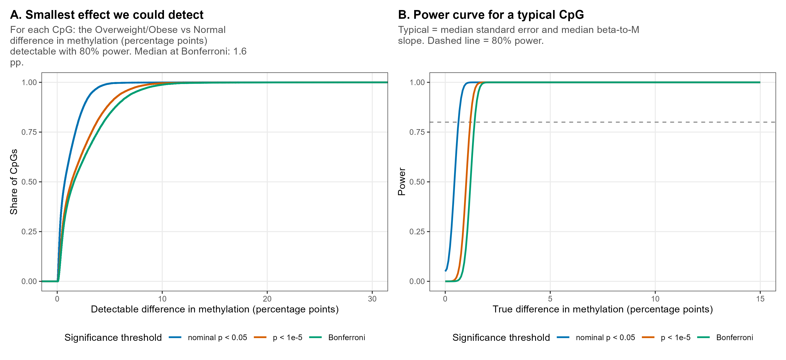
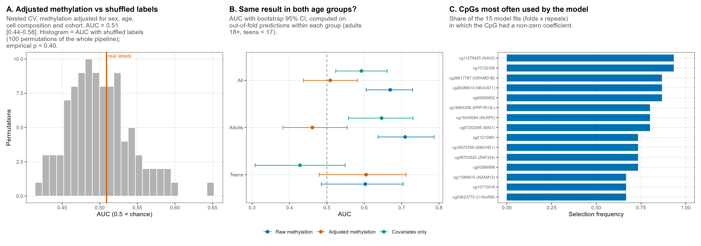

```{r setup, include = FALSE}
knitr::opts_knit$set(root.dir = normalizePath(".."))
knitr::opts_chunk$set(echo = TRUE, comment = "#>")
```

**Slides:** 11 (adjusted prediction), 12 (power), 13 (summary table); backup 23 (power
derivation).

Two questions remain after the EWAS:

1. How large would a difference have to be for this design to detect it? (power)
2. Could many tiny effects together predict the weight group, even if no single CpG is
   significant?

```{r packages}
source("R/functions.R")
need_objects(c("pheno", "beta_mat", "mvals_full", "anno"), "analysis/01_data_pca_umap.Rmd")
# objects of reports 4 and 5, used in the summary table at the end
need_objects(c("ewas_summary", "sensitivity", "kn", "k_same", "z_comb", "p_comb", "enrichment",
               "regions", "n_go_fdr"), "analysis/04 and 05")
```

## Settings

```{r settings}
GF2_SEED       <- 20261012
COHORT_AGE_CUT <- 17       # age < 17 = teenager cohort (nobody in the data is 17)
PRED_FOLDS     <- 5        # outer cross-validation folds
PRED_REPEATS   <- 3        # repeats of the outer cross-validation with different splits
PRED_NFEAT     <- 5000     # CpGs selected inside each training part
PRED_ALPHA     <- 0.5      # elastic net mixing: 0 = ridge, 1 = lasso
N_PERM_PRED2   <- 100      # label permutations of the whole prediction pipeline
N_BOOT         <- 500      # bootstrap resamples for the AUC confidence intervals
N_TOP_STABLE   <- 15       # CpGs in panel C of figure 16
PAL5 <- c("#0072B2", "#D55E00", "#009E73", "#CC79A7", "#E69F00")
set.seed(GF2_SEED)
```

## The main EWAS model once more

Power is computed from the standard errors of the main model M1 of report 4.

```{r m1}
group <- as.integer(pheno$weight.category %in% c("Overweight", "Obese"))
teen <- as.integer(pheno$age < COHORT_AGE_CUT)
cov_m1 <- data.frame(Sex = as.numeric(pheno$Sex) - 1, Age = pheno$age,
                     cellPC1 = pheno$cellPC1, cellPC2 = pheno$cellPC2)
cov_adj <- cbind(cov_m1, Teen = teen)
cat(sprintf("teens: %d (Overweight+Obese %d); adults: %d (Overweight+Obese %d)\n",
            sum(teen), sum(group[teen == 1]), sum(1 - teen), sum(group[teen == 0])))

r_m1 <- ols_scan(mvals_full, group, cov_m1)
check_scan_with_lm(r_m1, mvals_full, group, cov_m1, rows = sample(nrow(mvals_full), 10))
```

## 1. Power: the smallest detectable difference (slide 12, backup 23)

For one CpG the EWAS estimates the group difference b̂ in M-values and its standard error SE.
The test statistic is t = b̂ / SE.

1. **Threshold.** With no true difference, t follows a t-distribution with
   df = 355 − 6 = 349. A CpG is called significant if |t| > c, where c is chosen so that this
   happens with probability α: c = qt(1 − α/2, 349). For one test (α = 0.05) c = 1.97; for
   Bonferroni over 397,615 CpGs (α = 1.26·10⁻⁷) c = 5.40.
2. **Power 80 %.** If the true difference is δ, t is centred at δ / SE instead of 0 (with
   spread ≈ 1). For t to exceed c in 80 % of studies, its centre must lie 0.84 above c
   (0.84 = qnorm(0.8), the 80 % quantile of the standard normal). So the smallest detectable
   difference is ΔM = (c + 0.84) · SE.
3. **From M to beta.** Since M = log₂(β/(1 − β)), a small change in M changes β by
   ln2 · β(1 − β) times as much. Multiplying by 100 gives percentage points (pp) of
   methylation, at the mean β of each CpG.

Δβ_min (pp) = 100 · ln2 · β̄(1 − β̄) · (c + 0.84) · SE, computed for every CpG.

```{r power}
mean_beta <- rowMeans(beta_mat)
beta_per_m <- log(2) * mean_beta * (1 - mean_beta)            # d(beta) / d(M)
alphas <- c("nominal p < 0.05" = 0.05, "p < 1e-5" = 1e-5, "Bonferroni" = 0.05 / nrow(mvals_full))

min_detectable <- list()     # per threshold: detectable difference of every CpG, in pp
power_tab <- data.frame()
for (name in names(alphas)) {
  crit <- qt(1 - alphas[[name]] / 2, r_m1$df)
  min_detectable[[name]] <- 100 * (crit + qnorm(0.8)) * r_m1$se * beta_per_m
  v <- min_detectable[[name]]
  power_tab <- rbind(power_tab, data.frame(
    threshold = name, alpha = alphas[[name]], median_pp = median(v),
    q10_pp = quantile(v, 0.1, names = FALSE), q90_pp = quantile(v, 0.9, names = FALSE),
    share_le_2pp = mean(v <= 2), share_le_5pp = mean(v <= 5), share_le_10pp = mean(v <= 10)))
}
write.csv(power_tab, result_path("gf2_power.csv"), row.names = FALSE)
power_tab
bonf <- power_tab[power_tab$threshold == "Bonferroni", ]
```

**Figure 15.**

- **A.** For each threshold, the cumulative distribution over CpGs of the smallest detectable
  difference (a random 40,000 CpGs are drawn; the curve looks the same with all of them).
  CpGs with a value above 40 pp (very few) are left out of the plot. Read: at x = 5 pp the
  Bonferroni curve is at about 0.84, so for 84 % of CpGs a true difference of 5 pp would be
  detected with at least 80 % power (their smallest detectable difference is ≤ 5 pp).
- **B.** Power as a function of the true difference for a "typical" CpG (median SE and median
  β(1 − β) slope), computed exactly with the noncentral t-distribution. The dashed line marks
  80 % power; where each curve crosses it is the detectable difference of a typical CpG.

```{r fig15-power}
subset_cpgs <- sample(seq_along(r_m1$se), min(40000, length(r_m1$se)))
ecdf_data <- data.frame()
for (name in names(alphas)) ecdf_data <- rbind(ecdf_data, data.frame(threshold = name, v = min_detectable[[name]][subset_cpgs]))
ecdf_data <- ecdf_data[ecdf_data$v < 40, ]
ecdf_data$threshold <- factor(ecdf_data$threshold, levels = names(alphas))
pA <- ggplot(ecdf_data, aes(v, colour = threshold)) +
  stat_ecdf(linewidth = 0.9) +
  scale_colour_manual(values = PAL5[1:3], name = "Significance threshold") +
  coord_cartesian(xlim = c(0, 30)) +
  labs(title = "A. Smallest effect we could detect",
       subtitle = wrap_text(sprintf("For each CpG: the Overweight/Obese vs Normal difference in methylation (percentage points) detectable with 80%% power. Median at Bonferroni: %.1f pp.", bonf$median_pp), 55),
       x = "Detectable difference in methylation (percentage points)", y = "Share of CpGs") +
  theme_left() + theme(legend.position = "bottom")

typical_se <- median(r_m1$se)
typical_slope <- median(beta_per_m)
true_diff <- seq(0, 15, length.out = 200)                       # pp
curves <- data.frame()
for (name in names(alphas)) {
  crit <- qt(1 - alphas[[name]] / 2, r_m1$df)
  ncp <- (true_diff / 100 / typical_slope) / typical_se          # centre of t for this true difference
  curves <- rbind(curves, data.frame(threshold = factor(name, levels = names(alphas)), x = true_diff,
                                     power = 1 - pt(crit, r_m1$df, ncp) + pt(-crit, r_m1$df, ncp)))
}
pB <- ggplot(curves, aes(x, power, colour = threshold)) +
  geom_hline(yintercept = 0.8, colour = "grey50", linetype = "dashed") +
  geom_line(linewidth = 0.9) +
  scale_colour_manual(values = PAL5[1:3], name = "Significance threshold") +
  scale_y_continuous(limits = c(0, 1)) +
  labs(title = "B. Power curve for a typical CpG",
       subtitle = wrap_text("Typical = median standard error and median beta-to-M slope. Dashed line = 80% power.", 55),
       x = "True difference in methylation (percentage points)", y = "Power") +
  theme_left() + theme(legend.position = "bottom")
save_fig(pA | pB, "15_power", width = 12, height = 5.5)
```



## 2. Covariate-adjusted prediction of the weight group (slide 11)

**Model.** Elastic-net logistic regression (`glmnet`, α = 0.5): a logistic regression with a
penalty that shrinks most of the 5,000 coefficients to zero, so that a model can be
fitted with far more CpGs than people.

Every CpG is first replaced by its residual after regression on sex, age,
cellPC1/2 and cohort (teen vs adult). These covariates do not use the weight labels, so this
step cannot leak information about the outcome.

**Nested cross-validation**

1. Outer loop: people are split into 5 folds, keeping the share of Overweight/Obese the same in
   each fold. The model is trained on 4 folds and predicts the 5th, which it has not seen.
2. Inside each training part only: the 5,000 CpGs most correlated (|Pearson r|) with the label
   are selected, and the penalty λ is tuned by an inner 5-fold cross-validation
   (`cv.glmnet` - it builds a set of candidates from the data itself, `lambda.min`).
3. The outer split is repeated 3 times with different random splits; the out-of-fold scores
   are averaged.

**AUC**  = probability that a random Overweight/Obese person gets a
higher score than a random Normal-weight person: 0.5 = coinflip, 1 = perfect. Its 95 % CI is from
500 bootstrap resamples of people; the out-of-fold scores are resampled without refitting the
models, so the CI ignores the variation from training and is somewhat too narrow.

**Permutation test.** The labels are shuffled and the whole pipeline (including CpG
selection) is rerun, 100 times, with one cross-validation repeat each (the real AUC averages
three repeats, so the comparison is approximate; if anything, conservative).
p = (1 + number of shuffles with AUC ≥ observed) / (1 + 100).
Important to say taht 100 permutations would be insufficient to determine precision if the result were close to the threshold. I am familiar with the rule of thumb suggesting a number "significantly greater than 1/α" (where α is the threshold — for instance, if α = 0.05, then 1/α = 20, and typically ~1000 permutations are used); however, this is hardly necessary when the result is so far from the threshold. With p ≈ 0.4, as in our case, even 100 permutations yield an error of approximately ±0.05, and the conclusion—"not significant"—remains unchanged.

Three variants are compared: raw methylation, adjusted methylation, and the covariates alone
(logistic regression on sex, age, cellPC1/2 and cohort).

```{r prediction-functions}
# Residuals after the covariates: Y - projection of Y on the covariate space (rows of Y = CpGs)
Q_adj <- qr.Q(qr(cbind(1, as.matrix(cov_adj))))
residual_rows <- function(Y) Y - (Y %*% Q_adj) %*% t(Q_adj)

# Adjusted methylation of all CpGs (computed once, in chunks of 40,000 CpGs)
mvals_adj <- mvals_full
for (first in seq(1, nrow(mvals_full), by = 40000)) {
  rows <- first:min(first + 39999, nrow(mvals_full))
  mvals_adj[rows, ] <- residual_rows(mvals_full[rows, ])
}

# The k CpGs most correlated with y among the training people `train`
select_top_cpgs <- function(M, y_train, train, k) {
  yc <- y_train - mean(y_train)
  r <- numeric(nrow(M))
  for (first in seq(1, nrow(M), by = 40000)) {
    rows <- first:min(first + 39999, nrow(M))
    Y <- M[rows, train, drop = FALSE]
    Yc <- Y - rowMeans(Y)
    r[rows] <- as.numeric(Yc %*% yc) / (sqrt(rowSums(Yc^2)) * sqrt(sum(yc^2)) + 1e-12)
  }
  order(abs(r), decreasing = TRUE)[1:k]
}

# Random stratified folds: each class is spread evenly over the folds
make_folds <- function(y) {
  folds <- integer(length(y))
  for (cl in unique(y)) {
    members <- which(y == cl)
    folds[members] <- sample(rep(1:PRED_FOLDS, length.out = length(members)))
  }
  folds
}

# One run of the outer cross-validation. Returns the out-of-fold score of every person and
# (if record = TRUE) the CpGs with a non-zero coefficient in each fold's model.
cv_methylation <- function(y, adjust, record = FALSE) {
  folds <- make_folds(y)
  score <- rep(NA_real_, length(y))
  selected <- list()
  for (f in 1:PRED_FOLDS) {
    train <- which(folds != f)
    test <- which(folds == f)
    if (adjust) {
      top <- select_top_cpgs(mvals_adj, y[train], train, PRED_NFEAT)
      # the same projection as for mvals_adj, applied to the selected rows (kept like this so
      # that the numbers match the reference run to the last digit)
      X <- t(residual_rows(mvals_full[top, ]))
    } else {
      top <- select_top_cpgs(mvals_full, y[train], train, PRED_NFEAT)
      X <- t(mvals_full[top, ])
    }
    fit <- cv.glmnet(X[train, ], y[train], family = "binomial", alpha = PRED_ALPHA, nfolds = 5)
    score[test] <- as.numeric(predict(fit, X[test, ], s = "lambda.min", type = "link"))
    if (record) {
      coefs <- as.matrix(coef(fit, s = "lambda.min"))[-1, 1]     # without the intercept
      selected[[length(selected) + 1]] <- top[coefs != 0]
    }
  }
  list(score = score, selected = selected)
}

# The same outer cross-validation with the covariates only
cv_covariates <- function(y) {
  folds <- make_folds(y)
  score <- rep(NA_real_, length(y))
  d <- cbind(y = y, cov_adj)
  for (f in 1:PRED_FOLDS) {
    train <- which(folds != f)
    test <- which(folds == f)
    fit <- glm(y ~ ., data = d[train, ], family = binomial())
    score[test] <- as.numeric(predict(fit, d[test, ], type = "link"))
  }
  score
}

# 3 repeats of the cross-validation, each with its own seed; scores averaged over repeats
run_repeats <- function(adjust, seed0) {
  scores <- matrix(NA_real_, length(group), PRED_REPEATS)
  selected <- list()
  for (r in 1:PRED_REPEATS) {
    set.seed(seed0 + r)
    res <- cv_methylation(group, adjust, record = TRUE)
    scores[, r] <- res$score
    selected <- c(selected, res$selected)
  }
  list(score = rowMeans(scores), selected = selected)
}
```

```{r prediction}
real_raw <- run_repeats(adjust = FALSE, seed0 = GF2_SEED + 100)
real_adj <- run_repeats(adjust = TRUE, seed0 = GF2_SEED + 200)
cov_scores <- matrix(NA_real_, length(group), PRED_REPEATS)
for (r in 1:PRED_REPEATS) {
  set.seed(GF2_SEED + 300 + r)
  cov_scores[, r] <- cv_covariates(group)
}
cov_score <- rowMeans(cov_scores)

# AUC with bootstrap 95% CI, for all people and separately for adults and teens
bootstrap_ci <- function(score, y) {
  aucs <- numeric(N_BOOT)
  for (b in 1:N_BOOT) {
    i <- sample(length(y), replace = TRUE)
    aucs[b] <- auc_value(score[i], y[i])
  }
  quantile(aucs, c(0.025, 0.975))
}
all_scores <- list("Raw methylation" = real_raw$score, "Adjusted methylation" = real_adj$score,
                   "Covariates only" = cov_score)
strata <- list(All = rep(TRUE, length(group)), Adults = teen == 0, Teens = teen == 1)
auc_tab <- data.frame()
for (model in names(all_scores)) {
  for (stratum in names(strata)) {
    k <- strata[[stratum]]
    ci <- bootstrap_ci(all_scores[[model]][k], group[k])
    auc_tab <- rbind(auc_tab, data.frame(model = model, stratum = stratum, n = sum(k), cases = sum(group[k]),
                                         auc = auc_value(all_scores[[model]][k], group[k]),
                                         lo = ci[[1]], hi = ci[[2]]))
  }
}
write.csv(auc_tab, result_path("gf2_prediction_auc_by_stratum.csv"), row.names = FALSE)
auc_tab
adj_all <- auc_tab[auc_tab$model == "Adjusted methylation" & auc_tab$stratum == "All", ]
```

The permutation null takes most of the run time (100 × 5 `cv.glmnet` calls).

```{r permutation-null}
auc_null <- numeric(N_PERM_PRED2)
for (i in 1:N_PERM_PRED2) {
  set.seed(GF2_SEED + 1000 + i)
  y_perm <- sample(group)
  auc_null[i] <- auc_value(cv_methylation(y_perm, adjust = TRUE)$score, y_perm)
  if (i %% 10 == 0) cat(sprintf("permutation %d / %d\n", i, N_PERM_PRED2))
}
write.csv(data.frame(perm = 1:N_PERM_PRED2, auc_null = auc_null),
          result_path("gf2_prediction_auc_null_adjusted.csv"), row.names = FALSE)
p_perm_auc <- (1 + sum(auc_null >= adj_all$auc)) / (1 + N_PERM_PRED2)
cat(sprintf("Adjusted AUC = %.3f [%.3f; %.3f]; null: mean %.3f, max %.3f; permutation p = %.3f\n",
            adj_all$auc, adj_all$lo, adj_all$hi, mean(auc_null), max(auc_null), p_perm_auc))
```

**Stability of the model.** Over the 15 fits (5 folds × 3 repeats) of the adjusted model, how
often was each CpG given a non-zero coefficient? A stable signal would reuse the same CpGs.

```{r stable-cpgs}
n_fits <- length(real_adj$selected)
# how many fits selected each CpG; the names of the table are row numbers of mvals_full
selection_count <- sort(table(unlist(real_adj$selected)), decreasing = TRUE)
row_index <- as.integer(names(selection_count))
ai <- match(rownames(mvals_full)[row_index], rownames(anno))
stable <- data.frame(cpg = rownames(mvals_full)[row_index], freq = as.numeric(selection_count) / n_fits,
                     chr = anno$chr[ai], pos = anno$pos[ai], gene = short_gene_names(anno$UCSC_RefGene_Name[ai]),
                     stringsAsFactors = FALSE)
write.csv(head(stable, 500), result_path("gf2_predictor_stable_cpgs.csv"), row.names = FALSE)
cat(sprintf("Distinct CpGs used by the models: %d; in >= 50%% of the %d fits: %d\n",
            nrow(stable), n_fits, sum(stable$freq >= 0.5)))
```

**Figure 16** (slide 11 shows panels A and C).

- **A.** AUC of the adjusted model (red) against the AUCs of the 100 shuffled-label runs.
- **B.** AUC with 95 % CI by cohort for the three variants.
- **C.** The 15 CpGs selected most often.

```{r fig16-prediction}
pA <- ggplot(data.frame(v = auc_null), aes(v)) +
  geom_histogram(bins = 25, fill = "grey70", colour = "white") +
  geom_vline(xintercept = adj_all$auc, colour = "#D55E00", linewidth = 1) +
  annotate("text", x = adj_all$auc, y = Inf, label = "real labels", colour = "#D55E00",
           hjust = ifelse(adj_all$auc > mean(range(auc_null)), 1.05, -0.05), vjust = 1.5, size = 3.2) +
  labs(title = "A. Adjusted methylation vs shuffled labels",
       subtitle = wrap_text(sprintf("Nested CV, methylation adjusted for sex, age, cell composition and cohort. AUC = %.2f [%.2f-%.2f]. Histogram = AUC with shuffled labels (%d permutations of the whole pipeline); empirical p = %s.",
                                    adj_all$auc, adj_all$lo, adj_all$hi, N_PERM_PRED2,
                                    ifelse(p_perm_auc < 0.01, formatC(p_perm_auc, format = "e", digits = 1),
                                           formatC(p_perm_auc, format = "f", digits = 2))), 50),
       x = "AUC (0.5 = chance)", y = "Permutations") +
  theme_left()

auc_plot <- auc_tab
auc_plot$stratum <- factor(auc_plot$stratum, levels = rev(names(strata)))
auc_plot$model <- factor(auc_plot$model, levels = names(all_scores))
pB <- ggplot(auc_plot, aes(auc, stratum, colour = model)) +
  geom_vline(xintercept = 0.5, colour = "grey50", linetype = "dashed") +
  geom_errorbar(aes(xmin = lo, xmax = hi), width = 0.25, orientation = "y", position = position_dodge(width = 0.6)) +
  geom_point(size = 2.3, position = position_dodge(width = 0.6)) +
  scale_colour_manual(values = PAL5[1:3], name = NULL) +
  labs(title = "B. Same result in both age groups?",
       subtitle = wrap_text("AUC with bootstrap 95% CI, computed on out-of-fold predictions within each group (adults 18+, teens < 17).", 50),
       x = "AUC", y = NULL) +
  theme_left() + theme(legend.position = "bottom")

top_stable <- head(stable, N_TOP_STABLE)
top_stable$lab <- paste0(top_stable$cpg, ifelse(top_stable$gene != "", paste0(" (", sub(";.*", "", top_stable$gene), ")"), ""))
pC <- ggplot(top_stable, aes(freq, reorder(lab, freq))) +
  geom_col(fill = "#0072B2", width = 0.7) +
  scale_x_continuous(limits = c(0, 1)) +
  labs(title = "C. CpGs most often used by the model",
       subtitle = wrap_text(sprintf("Share of the %d model fits (folds x repeats) in which the CpG had a non-zero coefficient.", n_fits), 45),
       x = "Selection frequency", y = NULL) +
  theme_left() + theme(axis.text.y = element_text(size = 7))
save_fig(pA | pB | pC, "16_prediction_adjusted", width = 17, height = 6)
```



## Summary table (slide 13)

The table collects the numbers of reports 4–6 (objects still in memory).

```{r summary-table}
em <- enrichment[enrichment$window_bp == 5e5, ]
summary_table <- data.frame(
  analysis = c("EWAS, 397,615 CpGs (M1)", "Sensitivity, 7 models", "4 known BMI CpGs",
               "52 obesity loci, +-500 kb", "Region (DMR) scan", "Prediction, adjusted",
               "GO enrichment", "Power (Bonferroni)"),
  result = c(
    sprintf("%d FDR hits; lambda = %.2f", ewas_summary$n_fdr05[1], ewas_summary$lambda[1]),
    sprintf("FDR hits in %d of %d models; lambda %.2f-%.2f", sum(sensitivity$n_fdr05 > 0), nrow(sensitivity),
            min(sensitivity$lambda), max(sensitivity$lambda)),
    sprintf("%d/%d same sign; Z = %.2f, one-sided p = %.2f", k_same, nrow(kn), z_comb, p_comb),
    sprintf("%.1f%% vs %.1f%% of CpGs at p < 0.05; p = %.2f", 100 * em$frac_p05_observed,
            100 * em$frac_p05_random_mean, em$p_empirical_frac),
    sprintf("%d of %d regions with FWER < 0.05", sum(regions$p_fwer < 0.05), nrow(regions)),
    sprintf("AUC %.2f [%.2f-%.2f]; permutation p = %.2f", adj_all$auc, adj_all$lo, adj_all$hi, p_perm_auc),
    sprintf("%d terms with FDR < 0.05", n_go_fdr),
    sprintf("median detectable difference %.1f percentage points", bonf$median_pp)))
write.csv(summary_table, result_path("summary_table.csv"), row.names = FALSE)
knitr::kable(summary_table)
```

## Session information

```{r session-info}
sessionInfo()
```
